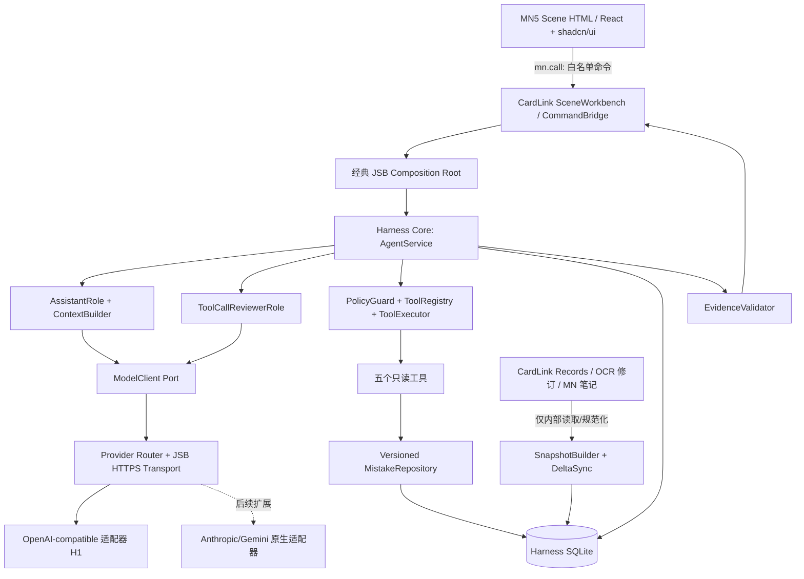

# CardLink Harness H1 — 完整技术设计规范 v2.20（调试入口）

> 当前交付安装包沿用已有版本。v2.17 源码为设备端显式装配工具协议 v2，旧装配继续使用 v1。v2.18 仅在现有 `getMistakeStats` 上加法扩展统计报表，不改变工具数量、协议与权限。参见 [§23](#23-v217-对话工具与设置改版方案)。

> 状态：架构基线 / 待真实 MN5 iPad P0 验证，不表示功能已经实现。
> 目标平台：MarginNote 5 场景模式（以 iPad 为首要验收设备）；经典 JSB 层兼容 CardLink v2.4.7 既有实现。
> 部署：单个 `.mnaddon` 内置，**不依赖 Node.js、localhost HTTP 服务或外部桌面进程**。
> 参考依据：用户提供《10 分钟学会设计 Agent 架构》视频文稿（领域层 / 应用层 / 适配层 / 组装根，Session / Context / Tool / ModelClient / Assistant / ToolCallReviewer / Decision / AgentService）；用户提供的 MN 开发文档（MN5 `window.mn`、场景 + 经典混合模式）；静态检查 `CardLink-v2.4.7.mnaddon`。
> 版本说明：v2.1 在 v2.0 的插件内一体化架构上，**修订模型接入为多服务商统一 `ModelClient` 接口**，Assistant 与 Reviewer 独立配置服务商/模型。H1 首期实现 OpenAI-compatible 协议适配器，Anthropic/Gemini 原生协议是可插拔后续扩展，不宣称已实现。其余 G1–G7、五工具、双重审核与只读边界不变。
> v2.2 修订（2026-11-14，用户决策）：在确定性 `PolicyGuard` 恒定先行、不可绕过的前提下，**新增会话级审核档位**（严格审核 / 溯源免审 / 完全允许，§10.1），定义工具调用何时需要模型 Reviewer 语义审核。档位动因：真机证据显示 Reviewer 对链式只读下钻调用存在系统性误拒，而其增量防护有限（§10.1 风险评估）。五工具白名单、只读边界、确定性检查、审计与证据校验全部不变。
> v2.3 修订（2026-11-14，用户决策：一键配置）：设置页从"手填 Base URL + 模型名"改为**粘贴 API Key 即可用**——客户端内置服务商预置表（Base URL 与默认模型），用户粘贴密钥后由 JSB 侧向该 endpoint 的 `GET {baseUrl}/models` 拉取真实模型列表供选择，失败时回退手动输入。新增 §5.1.6 与桥命令 `harness.listProviderModels`；模型目录请求复用既有 HTTPS 传输与 §12.3 的域名/重定向约束，不新增任意 URL 转发能力，密钥仍只存于本机 Harness SQLite。
> v2.4 修订（2026-11-15，用户决策：Agent 交互完善五项，经确认批准）：① `ModelClient` 增加可选方法 `generateDetailed`（读取服务商 `finish_reason` 与用量；`generate` 原签名与语义不变，冻结契约本体不动）；② §11 压缩口径由"H1 不实现 LLM 自动压缩"反转为"**构建时合成压缩摘要、不持久化新消息类型**"（§11.1）；③ §13 命令白名单新增会话管理/继续生成/导出/卡片定位命令（§13.1）；④ 模型回答引用协议 `{{card:ref_N}}`/`{{stat:ref_N}}` 与 `CitationResolver`/`AnswerPresenter` 冻结为 §10.1.1；⑤ `Session` 增量可选字段 `title`/`deletedAt`，`SessionStore` 端口加法扩展（§5）。审计/证据/运行记录在会话删除时永久保留（软删除语义，§13.1）。冻结契约清单（`RecordId`、`AgentMessage` 三类消息、`ToolCall`/`ToolResult`、`Decision`、`Context<T>`、`ToolEnvelope`、五工具白名单）不变。
> v2.5 修订（2026-11-15，用户决策：上下文与长回复优化，经确认批准"全做"）：① 新增 §5.2 `ModelCapabilities` / `ContextPlan` / `TokenUsage` 数据契约，按 provider+model 登记上下文窗口与输出上限，未知能力走保守配置并允许用户覆盖；② §11.1 压缩口径再次修订——由"构建时合成、**不持久化**"改为"**持久化压缩记录（`session_compactions`）、原文不删除**"，压缩摘要不再伪装为用户发言（构建期注入系统指令，见 §11.2）；③ `ContextBuilder` 增加 token 预算路径：`B_input = C − O − R`，85% 触发、近期保留 `min(20k, 40%·B_input)`，替代固定 40 轮/60,000 字符窗口；④ `runs` 增量记录 token 用量与"估算/实际"标记，估算器用服务商 `prompt_tokens` 校准；⑤ §13 新增 `harness.setModelCapabilities` / `harness.getModelCapabilities`，设置页与对话页展示上下文预算、用量、压缩次数与续答状态；⑥ `context_limit` 错误在压缩后自动重试一次。冻结契约（三类 `AgentMessage`、`Context<T>.messages` 类型、五工具白名单、PolicyGuard 先行、只读边界、证据链）不变——压缩摘要进入 `Context<T>.instruction` 而非消息数组。
> v2.6 修订（2026-11-15）：按 §9.1 扩展现有列表、统计工具的可选参数与结果，覆盖到期区间、累计复习次数排名、错因分布和复习时间区间汇总。复用已有快照投影，无 SQLite Schema 迁移。五工具白名单、冻结领域契约、审核档位与证据包络保持原契约。
> v2.7 修订（2026-11-15）：预算先恢复持久化摘要与切点之后的原文，按实际发送视图估算并触发压缩。增加压缩记录去重、压缩元数据和对话页状态（§5.2、§7、§11.1、§13）。
> v2.13 修订（2026-11-16，H1 工具可用性第一批）：按 §9.1 既有加法做法扩展三个只读工具的可选参数——`queryMistakes` 增加 `contentQuery`（单个字面短语检索）与 `recordIds`（1..10 个已知记录的批量元数据）；`getMistakeDetail` 增加显式 `content` 分段请求（按 Unicode 码点偏移、单字段、有界片段）；`getReviewHistory` 增加 `order`/`cursor`/`reviewFrom`/`reviewBefore`（默认仍升序 50 条）。新增 §9.2 定义语义、游标绑定、证据与范围边界；同时明确本轮检索实现口径（参数化 SQLite 字面匹配，FTS 列为后续优化）。冻结项（`RecordId`、三类 `AgentMessage`、`ToolCall`/`ToolResult`、`Decision`、`Context<T>`、`ToolEnvelope`、五工具白名单、PolicyGuard 先行、审核三档位、§12 发送范围）全部不变，不引入第六个工具。
> v2.14 修订（2026-11-16，上下文用量与费用可见）：① `ContextBuilder` 在构建时按**实际发送视图**输出可自洽的估算输入分项（系统指令 / 历史压缩摘要 / 工具定义 / 会话消息 / 工具结果 / 结构开销），分项之和恒等于 `ContextPlan.estimatedInputTokens`；② `AgentService` 在每个**真实** Assistant 请求上记录遥测行（`runId` + 请求序号、`sessionId`、provider+model、时间、分项与预算、用量来源、压缩关联、执行/计量状态），以 `(session_id, run_id, request_seq)` 幂等落 H1 SQLite，不复制 prompt、工具正文、OCR 或密钥；③ 新增本地费用估算（§22）：按调用当时的 provider+model 费率快照确定性计算，按设备本地日历聚合今日/近期并按币种隔离，未配置费率或用量缺失显示为缺失而非 0；④ §13 新增只读 `harness.getContextInsights` 与设置侧 `harness.getModelRate`/`setModelRate`/`clearModelRate`/`listModelRates`；⑤ §7 迁移 v13 新增 `assistant_requests`、`model_rates` 两张表（非破坏性，旧库不回填历史明细）。冻结契约（`RecordId`、三类 `AgentMessage`、`ToolCall`/`ToolResult`、`Decision`、`Context<T>`、`ToolEnvelope`、五工具白名单）、PolicyGuard 先行、审核档位、证据链、只读边界与快照口径全部不变；新增命令均为 UI/系统命令，不是模型工具。
> v2.16 修订（2026-11-16，H1 工具可用性第二批）：① **设备端答案正文**：普通 `harness.syncSnapshot` 在现有本地错题记录/OCR 汇总之外，按实际匹配的答案卡片投影**已授权、来源可定位**的纯文本答案（§6.1/§9.2）；答案来源以加法字段 `answerSourceNotebookId`/`answerSourceNoteId` 承载已核验的答案笔记身份，既有 `answerNotebookId`/`answerRootNodeId` 保留绑定根语义，**不得**再把答案脑图根当成答案正文或答案笔记；缺来源/多候选/索引不可用/空文一律显式不可用；设备新增答案正文只经显式 `content:{field:'answer'}` 分段发送，默认详情与旧 `includeText` 路径保持旧导入行为不变。② **快照过期感知**：新增本地源投影指纹基线与只读命令 `harness.getDataFreshness`（§6.3），基线只在成功导入后写入，旧安装无基线/同步失败/指纹不可计算按 `unknown`，UI 显示 `dataAsOf` 与 `current/stale/unknown`，运行始终锁定首次快照（§6.2/§11）。③ **确定性覆盖率报表**：`getMistakeStats` 加法支持 `report:'coverage'`（§9.3），按学习集/现有分类/自定义标签给出数量与题干、可授权且可定位的文本答案、可核验复习历史覆盖率，由 `StatisticsEngine`/参数化 SQLite 在同一快照与 scope 产生，键、分母、多值非互斥、空值、排序与上限在 §9.3 固定，并接入既有统计数字证据与引用校验。④ **分级运行预算**：新增用户可选三档（简单 4/8、多题比较 8/16、深度诊断 12/24）与每档总时限（§11.3），按 **Run** 全局计工具总量，受管理员配置硬上限约束，模型无选档或扩权能力。冻结项（`RecordId`、三类 `AgentMessage`、`ToolCall`/`ToolResult`、`Decision`、`Context<T>`、`ToolEnvelope`、五工具白名单、PolicyGuard 先行、审核三档位、§12 发送范围）全部不变；迁移 v14 为加法列与新表。
> v2.18 修订（2026-11-18，H1 工具可用性第三批）：在 `getMistakeStats` 上加法新增 `report:'repeatedReviewErrors'`（§9.4），用于"最近一段时间哪些题反复记录了错因 / 与前一时段相比复习情况如何"的跨题历史问答。只统计**可核实复习事件**（排除入册 mark 与无效时间）中**带非空可判定错因键**的事件；同一题至少两笔符合条件的复习记录才入榜，按事件数降序、`recordId` 升序、`limit` 有界。报表明确表述为"多次复习记录带错因（或重复记录同一错因）"，不宣称实际答错、正确率或因果。复用现有 `reviewActivity` 做两个时段的复习总量对比，不新增工具、不改 `ToolEnvelope` 结构、不改审核档位/PolicyGuard/工具计数/§12 发送范围，无 SQLite Schema 迁移；统计只由 `StatisticsEngine` + 参数化 SQLite 在同一锁定快照与 scope 内产生，证据回传 `snapshotId/dataAsOf` 与可见 `recordId`，并接入统计数字引用白名单。
> v2.20 修订（2026-11-20）：§13 将 AI 分析的三个用户入口收至调试开关，移除插件中供手动执行的 Harness P0 诊断页和命令。桌面自动化与阶段门槛继续按 §15、§16 和 §20 执行。
> v2.19 修订（2026-11-20）：§6.2 补充设备端分批投影和同源同范围无差异导入的快速路径。冻结契约、SQLite Schema、快照保留规则及 §6.3 的答案正文新鲜度边界沿用既有定义。
> 仓库采纳（2026-11-12）：本文档由用户提供并采纳为仓库强制规范（取代 v1.4）；`cardlink-harness/` 现有实现与本规范的逐项对照、字段映射与测试编号映射见 §21"实施对照"，待实现差异见 §21.3。AGENTS.md 引用本文件并要求严格遵守；修订须递增版本号并写明修订记录。

## 0. 冻结的关键决策

1. **MN5 场景面板是 UI**：React + shadcn/ui 静态资源，通过 `window.mn` / `mn.call` 与经典插件通信；只有当用户在 MN5 场景模板启用该插件后才调用场景 API。插件应提示启用条件，失败可显示明确故障状态。
2. **Harness Core 在经典 JSB JavaScript 运行时**：源码纯 TypeScript，编译成 JSB 能加载的 `HarnessCore.js`（或同等产物）；通过严格受限的经典 JSB Adapter 使用 CardLink 原始数据、独立 SQLite 和 HTTPS。**JSB 对 `Promise`、异步回调、现代语法等的实际可行性是 P0 门槛**；不可把"可以打包"视为"可以稳定执行"。
3. **单 Agent、双角色，模型配置相互独立**：Assistant 提出工具调用，独立的 ToolCallReviewer 生成 `Decision`。双方通过同一个 `ModelClient` 抽象调用模型，可分别选不同 `providerId / model / credentialRef / endpoint`；Reviewer 绝不拥有工具执行权，模型切换不得绕开 PolicyGuard 或五工具白名单。v2.2 起 Reviewer 的适用范围由会话审核档位决定（§10.1）：Reviewer 误批准仍被 PolicyGuard 拦截；档位降低审核强度不免除任何确定性检查。
4. **仅五个模型可见只读工具**：`queryMistakes`、`getMistakeDetail`、`getMistakeStats`、`getReviewHistory`、`listWeakPoints`。会话管理、运行状态、配置和快照导入是受控 **UI/系统内部操作**，不是模型工具。
5. **数据主权**：CardLink 现有存储为源数据；Harness SQLite 仅保留版本化只读投影、会话、运行状态、审计和派生数据。允许 Harness 写自己的 SQLite，但 **严禁写回 CardLink 原始数据、原笔记、标签或 OCR 手动修订**。
6. **信息完整与来源可追溯**：记录 `recordId = sourceNotebookId + ':' + sourceNoteId`，但始终把两段来源 ID 分字段保存，不靠简单 `split(':')` 解析。任何不可得字段用显式状态表示；保留源数据原始 JSON 以免丢失未来字段。
7. **H1 范围为 G1—G7**；AI 知识点/题型/解题法自动生成纳入单独扩展 **G8（H1.1，可选）**，需要用户确认并落到自己的派生表，不算五个工具、不得写回 CardLink。Embedding、Rerank、相似题聚类和长期记忆留待 H2/H3。
8. **（v2.2）审核档位是会话属性、用户可控**：每个会话带 `reviewLevel: 'strict' | 'provenance' | 'full_allow'`，默认 `'provenance'`；UI 在 AI 对话输入框下方提供切换器（§13），"完全允许"切换时一次性确认。档位只决定模型 Reviewer 是否参与，**不改变发给模型服务商的数据范围**（该范围仍由 §12.4 授权与工具设计决定），也不改变任何确定性检查、上限、截断、证据校验与审计。免审调用在审计中如实标记，不冒充已审核。

## 1. 核查到的 CardLink v2.4.7 现状与注意事项

- `mnaddon.json` 中有 `panel: index.html`、`marginnote_version_min: 4.0.0`，`main.js` 使用 `JSB.require('AnswerMatcherCore')`、`JSB.require('SceneWorkbench')` 等加载经典模块；包含 `web-dist/scene-entry.js` 及 `window.mn.call` 的场景通信代码。
- `AnswerMatcherCore.js` 使用 `Database.sharedInstance()`；存在 `globalThis.SQLiteDatabase.databaseWithPath` 的实现检测，且会检查 `executeUpdateWithArgumentsInArray` 与 `executeQueryWithArgumentsInArray`。能看到 SQLite 桥不代表新 Harness 的 WAL、事务、并发或回滚已通过设备验证。
- 错题存在 `records`、`sourceNotebookId`、`sourceNoteId`、`categoryPath`、`level`、`nextReviewAt`、`reviewCount`、`reviewCompleted`、`history`、`favorite` 等字段；另有原始标签与错因信息、OCR 相关代码。
- 现行等级 `0=不会 / 1=不熟 / 2=掌握`。现有到期谓词以本地次日零点（排他）为上限，同时排除 `reviewCompleted`；已有聚合统计中还会筛选 `noteAvailable`。
- `reviewCount` **不是历史总复习数**：在当前复习函数中，同级复习累加、等级改变时归零。它应单独命名为 `currentLevelReviewCount`；历史动作数应根据实际复习事件语义统计，禁止将两者混用。
- 旧版 H1 v1.0 曾认为插件没有 SQLite；这一点对最新 v2.4.7 已不成立。正式实施以最新包为准。

## 2. 产品目标 G1—G7 + 可选 G8

| 编号 | 必做目标 | 验收判据 |
|---|---|---|
| G1 | 稳定错题识别与查询 | 相同来源 ID 得到同一 `recordId`；字段合法、不会与其他笔记本碰撞；可打开原来源 |
| G2 | 脱离 AI 的确定性统计 | 不联网可得错题数、等级分布、到期数和清晰定义的复习指标；和 CardLink 同快照同时间口径逐项一致 |
| G3 | 持久化会话与模型工具循环 | 新建、继续、列表；FakeModel 跑通 User→Assistant→Reviewer→ToolResult→Assistant |
| G4 | 工具调用安全与审计 | PolicyGuard 恒定强制；独立 Reviewer 按审核档位适用（§10.1：严格/溯源免审/完全允许）；每个模型工具调用记录审计（含档位免审标记）；同一作用域内 `toolCallId` 幂等；中断可恢复 |
| G5 | 可验证证据回答 | 每个数量和单条记录事实均包含实际 `evidenceId` 或 `recordId`；引用只能指向本轮已获取且同快照证据 |
| G6 | 依赖倒置 | 更换模型、存储或 UI 桥不改 Domain / Application；共享 Fake Adapter 契约测试通过 |
| G7 | 完整数据投影 | 标题路径、分类、自定义标签、错因、收藏、OCR 原文及手工修订、答案关联、复习历史最大程度保留；不可得明确标记，保留 `raw_json` |
| G8（可选） | AI 知识点/题型/解法提取 | 用户启动的内部批处理产生版本化草稿，带证据和人工确认状态，不自动影响现有统计，不暴露第六个模型工具 |

**非目标**：任意 SQL/Shell、后台常驻 Agent、自动修改卡片、向量索引、跨设备即时同步、无用户授权的 OCR 内容外传、多 Agent、无上限循环、无来源的知识点准确率。

## 3. 完整运行拓扑



- UI 不直接运行 Agent，也不接收 API Key；`mn.api()` 仅做必要的场景状态、卡片定位等，Core 仍经经典适配器统一访问 CardLink 数据。
- `mn.api('/capabilities')` 仅用于确定 **MN5 场景白名单**。它不代表所有 CLI / 原生 API 都可访问。
- UI 执行 `harness.startRun` 返回 `runId`，用 `getRunStatus` / 受控事件接收进度，避免 WebView 等待一个数分钟的 `mn.call` Promise；此处命令是 UI → JSB 的系统命令，**不计入模型五工具**。
- 不新建 `127.0.0.1` 服务，没有 HTTP 入站端口；模型调用是插件到 HTTPS endpoint 的出站请求。

## 4. 分层设计与项目目录

**Domain**（纯 TS、无平台 API）：`Session`、`UserMessage`、`AssistantMessage`、`ToolCall`、`ToolResult`、`Decision`、`Context<T>`、`EvidenceRef`、`MistakeRecord`、`Snapshot`、`RunState`。
**Application**：`AgentService`、`AssistantRole`、`ToolCallReviewerRole`、`ContextBuilder`、`ToolRegistry`、`PolicyGuard`、`ToolExecutor`、`StatisticsEngine`、`EvidenceValidator`、`SnapshotService`、`RunRecoveryService`。
**Ports**（接口放 Domain/Application）：`ModelClient`、`ModelTransport`、`ModelCredentialStore`、`MistakeRepository`、`SessionStore`、`AuditStore`、`SnapshotSource`、`Clock`、`Logger`、`RunStore`。
**Adapters**：`ProviderRouterModelClient`、`OpenAICompatibleAdapter`（H1 首期）、预留 `AnthropicNativeAdapter` / `GeminiNativeAdapter`（不在 H1 必做范围）、`JSBHTTPSTransport`、`JSBSQLiteStore`、`CardLinkSourceAdapter`、`OCRSourceAdapter`、`MN5SceneBridge`；测试用 `FakeModelClient` / `InMemoryStore`。
**Composition Root**：仅 `bootstrap-jsb.ts` 感知所有具体实现。

```text
CardLink/
├── src/
│   ├── harness/
│   │   ├── domain/
│   │   ├── application/
│   │   │   ├── agent-service.ts
│   │   │   ├── assistant-role.ts
│   │   │   ├── reviewer-role.ts
│   │   │   ├── policy-guard.ts
│   │   │   ├── tool-executor.ts
│   │   │   ├── statistics-engine.ts
│   │   │   ├── evidence-validator.ts
│   │   │   ├── snapshot-service.ts
│   │   │   └── run-recovery.ts
│   │   ├── ports/
│   │   ├── adapters/jsb/
│   │   ├── adapters/model/
│   │   │   ├── provider-router.ts
│   │   │   ├── openai-compatible.ts      # H1 首期实现
│   │   │   ├── anthropic-native.ts       # 后续扩展，非 H1 必做
│   │   │   └── gemini-native.ts          # 后续扩展，非 H1 必做
│   │   ├── tools/          # 恰好五个模型可见工具
│   │   └── bootstrap-jsb.ts
│   ├── web/
│   │   ├── AgentPanel.tsx
│   │   ├── components/    # shadcn/ui 组件及适配
│   │   └── mn5-client.ts
│   └── tests/{unit,contracts,integration,fixtures}/
├── main.js                  # 现有入口，增量引入
├── HarnessCore.js           # 编译产物，具体模块可合并
├── AnswerMatcherCore.js     # 既有功能保持原样
├── SceneWorkbench.js
├── WebBridgeCommands.js
├── web-dist/
├── mnaddon.json
└── package.json             # 开发环境，不随插件要求用户安装
```

> 仓库现状映射（§21.1）：上述结构对应现有 `cardlink-harness/`（domain/application/ports/tools/adapters）+ 插件 `src/harness/`（JSB 集成层，待建）+ 插件 `web/src/`（AgentPanel，待建）。开发/回归工具链仍用 Node（tsx），但 Domain/Application 产物不得依赖 Node API。

兼容发布规则：现有 `mnaddon.json` 的 `marginnote_version_min: 4.0.0` 属于 CardLink 主插件的兼容承诺。H1 可作为 **MN5 场景模式限定功能** 做能力检测与功能开关；除非明确放弃 MN4 支持，否则不能为 H1 直接提高整个插件的最低版本或全局设置 `immersiveOnly: true`，以免破坏既有 MN4 用户入口。

构建规则：独立 Node 工具链仅用于**开发/打包**；运行产物不得依赖 `fs`、`process`、`Buffer`、原生 Node SQLite 模块、动态 import 或不兼容的 Web API；只使用经 P0 验证的 JSB 能力。初期勿把 Pi/Vercel SDK 直接硬依赖到 Core，先由最小原生 AgentService 保证可控性。

## 5. 领域接口（冻结 v1）

```ts
type RecordId = string;
type SnapshotId = string;
type SessionId = string;
type ToolCallId = string;

type ToolCall = {
  id: ToolCallId;
  name: string;
  args: unknown;
};

type UserMessage = { kind: 'user'; id: string; text: string; at: string };
type AssistantMessage = {
  kind: 'assistant'; id: string; text: string;
  toolCalls: ToolCall[]; at: string;
};
type ToolResult = {
  kind: 'tool_result'; id: string; toolCallId: ToolCallId;
  status: 'ok' | 'denied' | 'invalid_args' | 'timeout' | 'error';
  data: unknown; evidenceRefs: string[]; at: string;
};
type AgentMessage = UserMessage | AssistantMessage | ToolResult;

type Decision = { approved: boolean; reason: string };
interface OutputSchema<T> { name: string; parse(raw: unknown): T; jsonSchema: object }
interface Context<T> {
  instruction: string;
  messages: AgentMessage[];
  tools: ToolDefinition[];
  outputType: OutputSchema<T>;
  snapshotId: SnapshotId;
}
type ProviderId = string; // 配置标识，不等于模型厂商名称
// 保留 provider/model/credential 的明确边界，不在 Domain 中出现厂商专有字段。
type ModelSetting = {
  providerId: ProviderId;
  model: string;
  credentialRef: string;
  effort?: 'none' | 'low' | 'medium' | 'high';
  timeoutMs: number;
  maxOutputTokens: number;
  temperature?: number;
};
interface ModelClient { generate<T>(context: Context<T>, setting: ModelSetting): Promise<T> }
// v2.4 可选扩展（加法，不破坏冻结签名）：适配器实现 detailed 时 AgentService 优先使用；
// finishReason 枚举见 §11.1。未实现时退回 generate（无 finish_reason 可见性）。
interface ModelClientDetailed {
  generateDetailed<T>(context: Context<T>, setting: ModelSetting):
    Promise<{ value: T; finishReason: FinishReason; usage?: { promptTokens?: number; completionTokens?: number } }>;
}
// 由 Adapter 提供具体 endpoint、鉴权和协议转换；Context 不感知厂商。
interface ToolDefinition { name: string; description: string; inputSchema: object; readOnly: true }
interface Tool { definition: ToolDefinition; run(args: unknown, ctx: ToolContext): Promise<unknown> }
type ToolContext = { sessionId: SessionId; snapshotId: SnapshotId; notebookScope: string[] };
interface SessionStore {
  create(session: Session): Promise<void>;
  list(limit: number): Promise<SessionSummary[]>;
  get(id: SessionId): Promise<Session | null>;
  append(id: SessionId, event: AgentMessage): Promise<void>;
}
// v2.4 加法扩展（不破坏既有实现；Session 增量可选字段 title?: string、deletedAt?: ISODateTime，
// NULL/缺失按未删除、未命名读取）：
//   listSummaries(limit, { query? }): Promise<SessionSummary[]>
//     —— 不加载消息体；SessionSummary 至少含 { id, title?, updatedAt, createdAt, messageCount,
//        status, reviewLevel?, lastPreview? }；query 非空时按 title/lastPreview 匹配。
//   rename(id, title): Promise<void>       —— 标题非空、≤128 字符；写 updated_at。
//   softDelete(id): Promise<void>          —— 置 deletedAt；不物理删除任何行，
//                                             session_events/runs/tool_calls/audit/evidence 全保留。
// 列表与摘要一律过滤 deletedAt 非空项；get 对已删除会话仍可返回（供审计/恢复工具）。
interface MistakeRepository {
  query(snapshotId: string, filter: MistakeFilter, scope: string[]): Promise<MistakePage>;
  get(snapshotId: string, recordId: RecordId, scope: string[]): Promise<MistakeRecord | null>;
  stats(snapshotId: string, filter: MistakeFilter, scope: string[], now: Date): Promise<Stats>;
  history(snapshotId: string, recordId: string, scope: string[]): Promise<ReviewEvent[]>;
}
```

`ToolCallId` 幂等键至少使用 `(session_id, tool_call_id)`；如果上游 ID 可能在同一 Session 跨运行重复，必须校验工具名 + 规范化参数哈希相同，冲突时返回 `idempotency_conflict`，**不能复用不同操作的旧结果**。

> 仓库现状映射（§21.2）：现有实现保留 v1.x 字段形态（`type`/`createdAt`/`arguments`/`content`、ToolEnvelope 携带 evidence），与上文语义等价；桥接层（§13）对外输出 v2.1 形态。字段字面迁移在 P4 UI 集成时统一处理。

## 5.1 多服务商模型接入规范（v2.1 新增，冻结 H1 边界）

### 5.1.1 含义与范围

**OpenAI-compatible 指 API 请求/响应协议兼容，不表示仅支持 OpenAI 公司。** 可在相同协议适配器下配置不同提供方（例如 OpenAI、DeepSeek、阿里云百炼/Qwen、智谱/GLM、第三方兼容网关等），前提是**选定的具体 endpoint 和模型**通过 H1 的多轮对话、工具调用、工具结果续传、Reviewer 结构化决策等契约测试；不能以厂商品牌替代能力校验。

- **H1 必做**：一个 `OpenAICompatibleAdapter` + `JSBHTTPSTransport`，支持多套提供方配置和分别配置 Assistant / Reviewer；`FakeModelClient` 用于 TDD。
- **H1 不承诺**：Anthropic Claude、Google Gemini 的原生协议适配器已实现；如果对应服务提供经验证的兼容接口，可走兼容适配器，否则需要另写 `AnthropicNativeAdapter` 或 `GeminiNativeAdapter`。
- **不强制使用同一个供应商**：Assistant、Reviewer 可同 provider 不同 model，亦可跨 provider；**不会自动把任何错题内容转发到未经用户授权的备用供应商**。
- **纯本地模型**：如果存在与设备网络可达、已获授权且通过能力测试的 OpenAI 兼容 endpoint，可以使用相同适配器；但 iPad 插件无法自动连接 Mac 的 `127.0.0.1`，不在 H1 保证范围。

### 5.1.2 分层职责

```text
AgentService / AssistantRole / ReviewerRole
          ↓ 统一 Context<T> + ModelSetting
ModelClient (Application Port)
          ↓
ProviderRouterModelClient (根据 providerId 选择适配器)
          ↓
OpenAICompatibleAdapter [H1]  |  其他协议 Adapter [未来]
          ↓
JSBHTTPSTransport + ModelCredentialStore + ProviderConfigStore
          ↓
经过用户确认的 HTTPS 模型服务
```

- `ProviderRouterModelClient` 实现统一 `ModelClient.generate<T>`；Provider Adapter 负责请求参数、工具 schema、tool_call ID、tool-result 消息、停止原因、结构化输出和错误码的协议转换。
- `JSBHTTPSTransport` 只负责受控 HTTPS 请求和超时/取消；不可向模型或 WebView 暴露任意 URL 执行能力。
- `ModelCredentialStore` 以 `credentialRef` 间接索引密钥；`ModelSetting`、Session、Audit 中**不保存**原始密钥。
- Provider 配置的数据结构与密钥分离，所有 Provider Adapter 通过同一组契约测试，`AgentService` 不出现提供方名称或 URL 判断分支。

### 5.1.3 配置 Schema（示意）

```ts
type ModelProviderConfig = {
  id: string;                         // 例如 deepseek-main / qwen-review
  protocol: 'openai-compatible' | 'anthropic-native' | 'gemini-native';
  baseUrl: string;                    // 精确 HTTPS 地址，经用户确认和安全校验
  credentialRef: string;              // 密钥引用，不是密钥明文
  enabled: boolean;
};
type ModelRoleConfig = {
  assistant: ModelSetting;
  reviewer: ModelSetting;
};
// H1 的 protocol 只要求实现 openai-compatible；其他配置在适配器不存在时提示"不支持的协议"。
```

**配置示例（非真实 API Key 或可用性承诺）**：

```json
{
  "providers": [
    {"id":"deepseek-main", "protocol":"openai-compatible", "baseUrl":"https://api.deepseek.com", "credentialRef":"secret:deepseek", "enabled":true},
    {"id":"qwen-review", "protocol":"openai-compatible", "baseUrl":"https://dashscope.aliyuncs.com/compatible-mode/v1", "credentialRef":"secret:qwen", "enabled":true}
  ],
  "roles": {
    "assistant": {"providerId":"deepseek-main", "model":"deepseek-chat", "credentialRef":"secret:deepseek", "timeoutMs":60000, "maxOutputTokens":2048},
    "reviewer": {"providerId":"qwen-review", "model":"<由用户选择的、经能力校验的审核模型>", "credentialRef":"secret:qwen", "timeoutMs":30000, "maxOutputTokens":256}
  }
}
```

`baseUrl` 是示意配置，不是平台已验证通过的地址；最终请求路径由各 Provider Adapter 管理，不允许把用户提供的任意 URL 自动拼成开放代理。`providerId` 指向已启用的 `ModelProviderConfig`，`credentialRef` 应与配置中的密钥引用匹配；建议在校验期直接拒绝角色配置与 Provider 凭据不一致的情况。

### 5.1.4 最小能力探测与错误处理

在 P0/P3 添加无错题敏感信息的模型兼容性测试，至少验证：

1. 普通对话往返与认证、连接失败、超时及非 2xx 错误。
2. Assistant 返回**指定的五工具 Schema**之一时，Adapter 能无损生成内部 `ToolCall {id,name,args}`，再正确传回对应 `ToolResult` 让模型继续回复。
3. Reviewer 不接收工具声明，其结构化 `{approved:boolean, reason:string}` 可被校验；不支持标准 JSON Schema 响应模式时，可以尝试适配器已验证的 JSON 文本模式并严格解析，畸形响应 **fail-closed**。
4. 无工具能力的模型不得被标记为可用 Assistant；如无法形成可验证 Decision，也不得用于 Reviewer。不能悄悄跳过审核或降级为工具直接执行。
5. `ModelSetting.effort/temperature` 属可选抽象；厂商不支持时适配器按**显式可测的能力映射**处理，严禁直接假定参数名通用。
6. 模型切换不影响既有会话记录、工具幂等、审计与证据；只允许**用户确认后**在新的一次模型请求中使用新配置。
7. 模型响应里的工具调用不是授权指令，仍必须按 `PolicyGuard → 独立 Reviewer → ToolExecutor` 的顺序处理。

### 5.1.5 角色独立性与隐私

- Assistant / Reviewer 的 `providerId`、`model`、token/超时预算分别配置；其 **密钥也可以不同**。
- Reviewer 默认仅获取最小必要上下文和脱敏工具参数；跨服务商 Reviewer 可能导致错题数据发送至**第二家**服务商，必须在设置和首次启用时分别告知并取得许可。
- Provider 的配置切换和请求元数据可审计，但不记录 Authorization、API Key、完整敏感 OCR/题干、可重放签名。
- 不支持静默自动故障转移到其他服务商；Reviewer 失败必须拒绝工具请求，不允许"审核不可用则放行"。

### 5.1.6 一键配置与在线模型目录（v2.3 新增）

**目标**：把"配置 AI"压缩成"粘贴 Key → 选模型 → 完成"。用户不需要知道 Base URL 或模型名；需要覆盖时仍有手动入口。

**分层与边界**：

- 服务商预置表（Base URL、默认模型、密钥前缀提示）属**客户端静态数据**，只用于填写表单，不参与鉴权判断；预置地址不是可用性承诺，最终以用户保存的 `ModelProviderConfig.baseUrl` 为准。
- `GET {baseUrl}/models` 由 **JSB 侧**发起（`harness.listProviderModels`），Authorization 只在原请求头里出现：不进入 WebView 回包、不写日志、不写审计、不写 SQLite。WebView 只能传 `providerId`，**不能传 URL**。
- 请求复用 §5.1.2 的 `JSBHTTPSTransport`：HTTPS only、不跟随跨域重定向、显式超时（默认 20s）、响应体上限 512KB、模型条目上限 300。
- 返回值只含模型标识与抓取时间：`{ providerId, models: [{id, ownedBy?}], fetchedAt, source }`；`source` 区分 `network` 与 `manual`（手动兜底）。
- 错误码（fail-closed，UI 必须给出可操作提示）：`credential_missing`（未保存密钥）、`credential_invalid`（401/403）、`models_unsupported`（404 或响应无 `data` 数组）、`rate_limited`（429）、`provider_disabled`、`provider_not_found`、`model_catalog_timeout`、`model_catalog_failed`。
- 模型目录只用于**选择候选模型**，不代表该模型通过 §5.1.4 能力探测；"测试连接"仍按 §5.1.4.1 做一次最小往返，二者语义不同，UI 不得把列表存在当作可用性证明。
- 拿到列表后仍然调用既有 `harness.setModelRoleConfig` 写入角色模型；本修订不新增角色配置的读取能力（UI 仍不回显已保存模型名）。
- 隐私：模型目录请求只携带认证头，不携带任何错题/笔记内容。

## 5.2 模型能力与 token 预算（v2.5 新增，冻结）

**原则**：上下文窗口与最大输出量是**模型服务商能力**，不能由模型名推断；未知能力一律走保守配置，并允许用户显式覆盖。预算必须同时覆盖系统指令、工具定义、完整消息、工具结果与本次生成输出，而不是只统计聊天文字。

```ts
interface ModelCapabilities {
  providerId: string;
  modelId: string;
  contextWindowTokens: number;   // C：上下文窗口
  maxOutputTokens: number;       // 服务商允许的单次生成上限
  supportsToolCalls: boolean;
  supportsUsage: boolean;        // 服务商是否返回 prompt/completion tokens
  tokenEstimatorId: string;      // 估算器标识（校准按此 id 记录）
  source: "user" | "verified" | "provider" | "default";
  // user=用户覆盖；verified=仓库内已验证预置；provider=服务商目录/文档；
  // default=未知能力的保守回退（不作为"已确认能力"展示）
}

interface ContextPlan {
  inputBudgetTokens: number;     // B_input = C − O − R
  estimatedInputTokens: number;
  outputBudgetTokens: number;    // O：本次有效生成上限
  reservedTokens: number;        // R：安全余量
  requiresCompaction: boolean;   // 预计输入 > 85% · B_input
  includedMessageIds: string[];
  compactionId?: string;         // 本次请求采用的持久化压缩记录
}

interface TokenUsage {
  promptTokens?: number;
  completionTokens?: number;
  totalTokens?: number;
  estimated: boolean;            // true=估算（服务商未返回用量或未实现 detailed）
}
```

**预算规则（冻结）**：

1. `O = min(用户配置的 maxOutputTokens, capabilities.maxOutputTokens, C − R − 最小输入预算)`；`B_input = C − O − R`。
2. `R` 默认 4,096 token；`B_input` 低于 2,048 token 时拒绝发起请求（`context_budget_insufficient`），不静默缩水。
3. 按有效输入判断压缩：系统指令、已有压缩摘要、切点起的消息（包含工具正文裁剪后的结果）、工具定义和续答指令。估算超过 `floor(0.85 × B_input)` 时触发压缩（阈值可配置，初始值 0.85）。
4. 近期原文保留预算 `min(20_000, 0.4 × B_input)`，不得因"固定 40 轮"越过预算。
5. 有效输入估算不得超过 `B_input` 硬上限。压缩后仍超限时返回明确错误，不向服务商发出请求。
6. 估算必须有据：优先使用模型对应 tokenizer；H1 采用**保守语言感知估算器**（CJK 按字计、拉丁按 ~3 字符/token、JSON 结构字符计入），并用服务商返回的 `prompt_tokens` 按 provider+model 校准（校准系数持久化，限幅 0.5–2.0）。
7. 服务商未返回用量时，`TokenUsage.estimated = true`；UI 必须标注"估算"，不得展示虚假精确值。

**能力来源优先级**：用户覆盖（`user`）> 内置已验证预置（`verified`）> 服务商目录（`provider`，仅当目录明确给出窗口/上限）> 保守默认（`default`：32K 窗口、8,192 输出、支持工具与用量未知按不支持处理）。

## 6. 数据模型与同步协议

### 6.1 CardLink 原始数据投影

建议 `MistakeRecord` 的顶层结构：

```ts
type MistakeRecord = {
  recordId: string;
  sourceNotebookId: string;
  sourceNoteId: string;
  sourceAvailable: boolean | null;
  sourceNotebookTitle?: string;
  sourceRootTitle?: string;
  sourcePathTitles: string[];
  sourceTitle?: string;
  categoryPath: string[];
  manualCategories: string[];
  customTags: string[];
  reasonTags: string[];
  favorite?: boolean;
  level: 0 | 1 | 2 | null;
  currentLevelReviewCount: number | null; // 原 reviewCount，非累计
  reviewCompleted?: boolean;
  nextReviewAt?: string;
  lastReviewedAt?: string;
  history: unknown[];                 // 原始事件及原始字段无损
  questionText?: string;
  answerText?: string;
  /** v2.16：答案正文来源。'answer_card' = 设备同步时按实际匹配答案卡片投影的纯文本；
   * 缺失/'import' = 旧导入载荷提供的答案正文（保持旧行为）。 */
  answerTextOrigin?: 'import' | 'answer_card';
  /** v2.16：已核验的实际答案笔记身份（来自答案索引/绑定匹配，不是答案脑图根）。 */
  answerSourceNotebookId?: string;
  answerSourceNoteId?: string;
  /** v2.16：答案投影状态；不可用时给出显式原因，不伪造正文。 */
  answerStatus?: 'projected' | 'unavailable' | 'missing';
  answerReason?: 'answer_source_unbound' | 'answer_not_found' | 'answer_index_unavailable'
    | 'answer_ambiguous' | 'answer_note_unavailable' | 'answer_text_empty';
  ocr: {
    rawText?: string; manualText?: string; effectiveText?: string;
    origin: 'manual' | 'ocr' | 'note' | 'none';
    status: 'complete' | 'partial' | 'missing';
    version?: string; updatedAt?: string;
  };
  sourcePayload: Record<string, unknown>; // 原始字段无损保留
  fieldAvailability: Record<string, 'present' | 'missing' | 'unverified'>;
  contentHash: string;
};
```

规则：
1. 优先读取 CardLink 原始记录；以**单独的、只读的** MN 笔记/OCR 适配器补充文本和答案。资料关联优先精确来源 ID，不根据题干相似度强制合并。
2. OCR 的有效文本优先手动修订，再次选机器 OCR；保留原始文本和修订版本，避免下一次扫描覆盖人工修改。实际优先级须对齐 CardLink 当前实现。
3. `sourcePayload/raw_json` 记录保留源中的新字段。未经验证字段不得推定存在，例如"收藏"缺失不等于 `false`，没有 OCR 不等于题干为空。
4. 自定义分类、笔记标题层级、标签、错因分别存储，不能把 `categoryPath` 自动等同知识点；`listWeakPoints` 只用**人工确认或已有规范知识点标签**。
5. 独立提供的 `customTags`（包括空数组）与 `manualCategories` 分别投影。CardLink 插件快照（`sourceId: "cardlink-plugin"`）和 v2 插件备份缺少 `customTags` 时，其历史字段 `manualCategories` 表示自定义标签，旧版单数 `manualCategory` 只在标签数组为空时补用。这类记录的手动分类投影为空，原始字段留在 `sourcePayload/raw_json`。其他快照缺少 `customTags` 时保留手动分类，标签留空。重新导入后采用此口径，历史快照保留既有投影。
6. 不修改 CardLink 数据；即使 H1 将来生成知识点/题型，也只写自己的派生表。
7. **（v2.16）答案正文只来自实际匹配的答案卡片**：设备端普通 `harness.syncSnapshot` 在错题记录与 OCR 汇总之外，按插件现有只读候选逻辑（绑定 → 答案匹配索引 → 去重 → 排除题目卡片本身）确定**唯一**匹配的答案卡片，再以该卡片现有文本抽取口径（评论 > 摘录 > 子卡片，纯文本，不渲染 HTML/图片）得到答案正文。
   - 来源分字段保存为 `answerSourceNotebookId` / `answerSourceNoteId`（实际匹配的答案笔记）；`answerNotebookId` / `answerRootNodeId` 继续表示绑定目标/答案脑图根，**不得**当作答案正文或答案笔记身份。
   - 无绑定、索引未建立/不可用、无匹配、多个候选无法唯一确定、匹配笔记已不可读、卡片无文本时，`answerStatus='unavailable'|'missing'` 并给出 `answerReason`；不以根标题、根正文、预览 HTML、题目卡片或任意候选兜底。
   - 该投影只读：不刷新索引、不写错题库、不修改绑定与笔记；批量同步按批次共享答案索引与跨学习集卡片解析缓存，不逐题重建索引。
   - `answerTextOrigin='answer_card'` 的正文只经 `getMistakeDetail.content:{field:'answer'}` 分段按 §12 范围发送；默认详情与旧 `includeText` 路径保持旧导入响应行为（不自动带出设备新增答案正文）。

### 6.2 Snapshot 协议

```ts
type SnapshotManifest = {
  schemaVersion: 1;
  snapshotId: string;
  source: 'cardlink';
  sourceRevision: string;
  importedAt: string;
  scope: { notebookIds: string[] };
  complete: boolean;
  recordCount: number;
  hash: string;
};
```

- 主路径是**插件内 SnapshotBuilder → Harness SQLite 投影**，无需导出到 PC；可保留手动导出作排障/备份手段。
- 完整快照替换同范围数据版本；增量快照必须校验 `baseRevision` 并将差异合成新的完整逻辑视图；局部/范围不全的快照不能将没出现的记录视为删除。
- 使用事务提交，发生异常整批回滚；同 ID + 同 hash 重复同步不得产生重复事件。保存 `snapshot_id`、`dataAsOf`、`sourceRevision`、完整性及缺失统计。
- 一次 Agent 运行锁定 `snapshotId`；统计与详情不能跨两个快照混算。快照垃圾回收不得删掉仍被运行或证据引用的版本。
- Run 入列时锁定快照，工具结果及证据沿用该快照和其 `dataAsOf`。同源同范围最新快照的逻辑视图未变化时复用快照，导出时间与记录顺序不影响去重。数据变化后回到旧内容仍产生新快照；增量基线在 SQLite 事务内核对。
- 设备端显式同步分批读取答案文本，每批之间让出 JSB 线程。同一运行时并发同步共用正在进行的任务。常规同步在读取完设备来源后按行比较哈希。若无需修改或删除，直接复用基线快照，省去读取其正文、组装新版本和写入。发生变更时仍按既有事务和作用域规则生成完整逻辑视图。答案正文没有可供 §6.3 使用的版本信号，用户触发同步时仍逐条核对。

### 6.3 本地源变化感知与快照新鲜度（v2.16 新增）

**目标**：让用户不要求常驻后台也能知道"本地错题/OCR 是否已不同于上次成功导入的快照"，而不是只看到导入时间或依赖 TTL。

1. **本地源投影指纹**（插件侧、只读、轻量）：对**当前 CardLink 本地错题记录**与 **OCR 行**做规范化投影后计算 SHA-256 指纹，覆盖：
   - 记录集合：`recordId`（新增/删除/ID 更换）、`level`、`errorReasons`/`reasonTags`、`reviewCompleted`、`nextReviewAt`、`currentLevelReviewCount`、`favorite`、`customTags`/`manualCategories`（用户手动标签与分类）；
   - OCR 行：`record_id`、`manual_text`、`effective_text`、`ocr_text`、`status`（增删与修订）；
   - 答案绑定：每个题目作用域的答案目标 `answerNotebookId` + `answerRootNodeId`（绑定改变会使答案投影失效）。
   - 指纹按稳定排序的规范化 JSON 计算，不依赖导出时间、记录插入顺序或最新 `updatedAt` 单字段。数据未修改时同一指纹稳定；任何上述字段增删改都改变指纹。
   - **答案卡片正文的编辑不进入轻量指纹**（答案卡片属于笔记库，本地没有无需遍历即可读取的版本信号）。因此新鲜度结果必须带 `answerChanges: 'not_tracked'`，并在 UI/文档明确"答案正文可能已变化，需同步刷新"；**不得**把该维度报告为 `current`。指纹计算不使用 TTL，也不扫描学习集卡片。
2. **基线**：`source_baselines(source_id, fingerprint, snapshot_id, updated_at)`。基线**只在该次导入成功返回快照后**写入，记录同一 `snapshot_id` 与同一指纹；导入失败、指纹不可计算、旧安装从未同步时不写基线（旧值保留）。
3. **判定**（`harness.getDataFreshness`，只读 UI/系统命令）：
   - `current`：存在基线，且当前指纹等于基线指纹，且基线 `snapshotId` 等于当前最新快照；
   - `stale`：存在基线，但当前指纹不同，或最新快照不是基线记录的那一版（例如其他来源导入了新快照）；
   - `unknown`：无基线（首次/旧安装）、基线读取失败或当前指纹无法计算。
   - 结果同时返回 `dataAsOf`、`snapshotId`（最新）、`baselineSnapshotId`、`baselineFingerprintAt`、`checkedAt`、`tracked` 维度说明、`answerChanges` 与不可用原因。判定比较的是**投影指纹**，不承诺检测答案卡片正文。
4. **运行语义**：Run 仍锁定入列时的 `snapshotId` 与该快照 `dataAsOf`；新鲜度变化不修改已结束/进行中 Run 的快照、工具结果与证据。UI 明确提示"新数据可同步；已开始的运行仍读原快照，下一轮使用新快照"。旧会话历史与证据按各自快照保留，恢复/继续生成沿用该会话最近一次 Run 的锁定快照（§11）。
5. **并发与失败**：指纹在导入前计算并随该次同步请求携带；导入事务成功后才写基线。并发修改发生在计算之后、导入之前时，下一次检查会得到 `stale`（基线记录的是导入时的指纹），不会谎报 `current`。同步失败不更新基线；重启后从 SQLite 读取基线，判定一致（不依赖内存状态）。

## 7. SQLite 最小正式 Schema

```sql
PRAGMA foreign_keys = ON;
CREATE TABLE IF NOT EXISTS schema_migrations (
  version INTEGER PRIMARY KEY,
  applied_at TEXT NOT NULL
);
CREATE TABLE IF NOT EXISTS snapshots (
  snapshot_id TEXT PRIMARY KEY,
  source_revision TEXT NOT NULL,
  complete INTEGER NOT NULL,
  scope_json TEXT NOT NULL,
  imported_at TEXT NOT NULL,
  data_as_of TEXT NOT NULL,
  source_hash TEXT NOT NULL
);
CREATE TABLE IF NOT EXISTS mistake_projection (
  snapshot_id TEXT NOT NULL REFERENCES snapshots(snapshot_id),
  record_id TEXT NOT NULL,
  notebook_id TEXT NOT NULL,
  note_id TEXT NOT NULL,
  source_available INTEGER,
  level INTEGER,
  current_level_review_count INTEGER,
  review_completed INTEGER,
  next_review_at TEXT,
  last_reviewed_at TEXT,
  favorite INTEGER,
  category_path_json TEXT NOT NULL,
  manual_categories_json TEXT NOT NULL,
  custom_tags_json TEXT NOT NULL,
  reason_tags_json TEXT NOT NULL,
  raw_json TEXT NOT NULL,
  ocr_json TEXT,
  content_hash TEXT NOT NULL,
  PRIMARY KEY(snapshot_id, record_id)
);
CREATE INDEX IF NOT EXISTS idx_mistakes_due
  ON mistake_projection(snapshot_id, next_review_at);
CREATE INDEX IF NOT EXISTS idx_mistakes_notebook
  ON mistake_projection(snapshot_id, notebook_id);
CREATE TABLE IF NOT EXISTS sessions (
  session_id TEXT PRIMARY KEY,
  scope_json TEXT NOT NULL,
  created_at TEXT NOT NULL,
  updated_at TEXT NOT NULL,
  status TEXT NOT NULL
);
CREATE TABLE IF NOT EXISTS session_events (
  event_id TEXT PRIMARY KEY,
  session_id TEXT NOT NULL REFERENCES sessions(session_id),
  sequence_no INTEGER NOT NULL,
  kind TEXT NOT NULL,
  payload_json TEXT NOT NULL,
  created_at TEXT NOT NULL,
  UNIQUE(session_id, sequence_no)
);
CREATE TABLE IF NOT EXISTS runs (
  run_id TEXT PRIMARY KEY,
  session_id TEXT NOT NULL REFERENCES sessions(session_id),
  snapshot_id TEXT NOT NULL REFERENCES snapshots(snapshot_id),
  status TEXT NOT NULL,
  phase TEXT NOT NULL,
  iteration INTEGER NOT NULL,
  last_error TEXT,
  updated_at TEXT NOT NULL
);
CREATE TABLE IF NOT EXISTS tool_calls (
  session_id TEXT NOT NULL REFERENCES sessions(session_id),
  tool_call_id TEXT NOT NULL,
  run_id TEXT NOT NULL REFERENCES runs(run_id),
  tool_name TEXT NOT NULL,
  args_hash TEXT NOT NULL,
  policy_status TEXT NOT NULL,
  reviewer_status TEXT NOT NULL,
  reviewer_reason TEXT,
  execution_status TEXT NOT NULL,
  result_json TEXT,
  evidence_json TEXT,
  updated_at TEXT NOT NULL,
  PRIMARY KEY(session_id, tool_call_id)
);
CREATE TABLE IF NOT EXISTS audit_events (
  audit_id TEXT PRIMARY KEY,
  run_id TEXT NOT NULL REFERENCES runs(run_id),
  tool_call_id TEXT,
  event_type TEXT NOT NULL,
  sanitized_json TEXT NOT NULL,
  at TEXT NOT NULL
);
CREATE TABLE IF NOT EXISTS evidence (
  evidence_id TEXT PRIMARY KEY,
  run_id TEXT NOT NULL REFERENCES runs(run_id),
  snapshot_id TEXT NOT NULL REFERENCES snapshots(snapshot_id),
  source_type TEXT NOT NULL,
  source_ref TEXT NOT NULL,
  result_hash TEXT NOT NULL,
  generated_at TEXT NOT NULL
);
-- v2.5 §11.1：持久化压缩记录（只影响发给模型的上下文视图；session_events 原文不删）
CREATE TABLE IF NOT EXISTS session_compactions (
  id TEXT PRIMARY KEY,
  session_id TEXT NOT NULL REFERENCES sessions(session_id),
  first_kept_message_id TEXT NOT NULL,
  summary TEXT NOT NULL,
  snapshot_id TEXT,
  tokens_before INTEGER,
  tokens_after INTEGER,
  model_id TEXT,
    last_compressed_sequence_no INTEGER,
    summary_hash TEXT,
    trigger_reason TEXT,
  created_at TEXT NOT NULL
);
CREATE INDEX IF NOT EXISTS idx_compactions_session
  ON session_compactions(session_id, created_at);
CREATE INDEX IF NOT EXISTS idx_compactions_boundary
  ON session_compactions(session_id, first_kept_message_id);
-- v2.5 §5.2：模型能力与估算校准（按 provider+model 唯一）
CREATE TABLE IF NOT EXISTS model_capabilities (
  provider_id TEXT NOT NULL,
  model_id TEXT NOT NULL,
  context_window_tokens INTEGER NOT NULL,
  max_output_tokens INTEGER NOT NULL,
  supports_tool_calls INTEGER NOT NULL,
  supports_usage INTEGER NOT NULL,
  token_estimator_id TEXT NOT NULL,
  source TEXT NOT NULL,
  calibration_ratio REAL,
  updated_at TEXT NOT NULL,
  PRIMARY KEY(provider_id, model_id)
);
```

> v2.5 增量列（非破坏性迁移）：`runs` 增加 `prompt_tokens`、`completion_tokens`、`total_tokens`、`usage_estimated`（INTEGER，NULL 表示服务商未返回且未估算）；`turn_results.result_json` 内的 `usage` 与之同源。`session_compactions` 不级联删除原始消息；软删除会话时压缩记录一并保留，彻底删除（`purgeSession`）时随之清除。

> v2.16 迁移 v14（非破坏性，均为加法）：
> - `mistake_projection_v2` 新增 `answer_text_origin TEXT`、`answer_source_notebook_id TEXT`、`answer_source_note_id TEXT`、`answer_status TEXT`、`answer_reason TEXT`。旧行保持 NULL：语义等同 `answerTextOrigin='import'`（旧导入路径），答案来源按 v2.13 旧口径（`answer_notebook_id`+`answer_root_node_id`）读取，不伪造新来源。
> - `runs` 新增 `budget_tier TEXT`（NULL = 旧调用/未选档，按管理员配置上限运行）；`sessions` 新增 `budget_tier TEXT`（NULL 按简单档读取，仅影响 UI 初始选中值）。
> - 新表 `source_baselines(source_id TEXT PRIMARY KEY, fingerprint TEXT NOT NULL, snapshot_id TEXT NOT NULL, updated_at TEXT NOT NULL)`（§6.3）。
> - 不新增工具、不改变 `ToolEnvelope`，不改写历史快照行。

注：上述是建议的关系结构，JSB SQLite 是否支持预期事务、WAL、BLOB 和外键需通过 P0 设备契约测试。必要时可将 SQLite 写操作串行化并使用保守日志模式，不得假设 WAL 无条件可用。`run`/`tool_calls` 事务边界由一个 `UnitOfWork` 管理，避免审计事件和工具结果互相不一致。

> 仓库现状映射（§21.3，2026-11-14 更新）：版本化投影已落地（migration v4 清单+v2 投影，migration v5 补 evidence 表并重建 review_events 去除旧表外键）；旧 MistakeRepository 端口经 `VersionedBackedMistakeRepository` 跑在 v2 投影上（latest 视图 + `forSnapshot` 运行锁定），工具/AgentService/桥/统计引擎已全部切换；`harness.getEvidence` 已按本表 evidence 结构提供真实查询。

## 8. 确定性统计标准（G2）

将插件原口径冻结为可测试的纯函数，计算时使用同一来源快照、用户设备本地时区和时钟注入。

```ts
function isDue(r: MistakeRecord, now: Date): boolean {
  if (r.sourceAvailable !== true || r.reviewCompleted === true) return false;
  const dueMs = Date.parse(r.nextReviewAt ?? '');
  if (!Number.isFinite(dueMs)) return false;
  const tomorrow0 = new Date(
    now.getFullYear(), now.getMonth(), now.getDate() + 1
  ).getTime();
  return dueMs < tomorrow0;
}
```

**G2 返回字段规范**：
- `totalRecords`：本快照已登记错题总数。
- `availableRecords`：确认来源仍存在的错题数，不能与总数混用。
- `levelCounts[0..2]`：所有纳入当前筛选口径错题的等级分布。
- `dueCount`：按上述谓词的应复习数（包括逾期及今天到期，排除完成与无效日期、来源不可用）。
- `reviewedRecordCount`：有可核实复习行为的错题数；不是同级连击次数。
- `totalReviewActions`：仅在历史事件能明确分辨"创建记录"和"真实复习动作"时提供；否则 `null` 并标记原因。
- `currentLevelReviewCountSum`：原 CardLink `reviewCount` 的求和，仅作为辅助指标，**不能标成"累计复习次数"**。
- `dataAsOf`、`snapshotId`、`timeZone`、`filter`：每次统计必返。

**边界案例测试**：昨天逾期、今天 23:59:59、明天 00:00:00、无效日期、完成标记、来源不可用、设备跨 DST 时区、同级重复与跨级重置。

## 9. 五个只读工具——稳定模型协议

| 工具名 | 输入（示意） | 输出（示意） | 强制限制 |
|---|---|---|---|
| `queryMistakes` | `subject?,notebookIds?,level?,unmastered?,dueFrom?,dueBefore?,orderBy?,limit?,cursor?,contentQuery?,recordIds?` | `records[],nextCursor?,reviewCoverage?,missingRecordIds?,evidence` | 默认 20，累计复习次数排序默认 10，最多 50；`contentQuery` 1..128 字面短语，`recordIds` 1..10 个 |
| `getMistakeDetail` | `recordId,includeText?,content?` | `record,OCR来源,字段可用性,evidence,contentSegment?` | 单记录，OCR 文本截断标记；分段 `offset≥0`、`limit` 1..4000 码点 |
| `getMistakeStats` | `subject?,notebookIds?,from?,to?,statsTime?,timezone?,report?,reviewFrom?,reviewBefore?,limit?` | G2 统计或指定报表（`errorReasons`/`reviewActivity`/`coverage`/`repeatedReviewErrors`）、`snapshotId/dataAsOf/evidenceId` | 由 StatisticsEngine 与 SQL 计算；`coverage` 分组默认 20、最多 50；`repeatedReviewErrors` 记录默认 20、最多 50 |
| `getReviewHistory` | `recordId,limit?,order?,cursor?,reviewFrom?,reviewBefore?` | `events[],nextCursor?,total,totalMatching?,historyCompleteness,evidence` | 单记录，最多 100 条；游标绑定记录/排序/快照/过滤条件 |
| `listWeakPoints` | `notebookIds?,subject?,minSamples?` | `status,points[],evidence` | 无可确认知识点标签时 `insufficient_labels` |

### 9.1 常用查询（v2.6）

- `unmastered: true` 同时匹配等级 0 和 1，未知等级排除，与单等级筛选取交集。到期区间为 `[dueFrom, dueBefore)`，可省略一端。到期查询和 G2 到期数共用可用卡片、未完成复习、有效到期时间的谓词。今天待复习用本地次日零点作上界，包含逾期。筛选边界用带时区的 ISO 时间。
- `orderBy` 支持 `dueAtAsc` 和 `reviewCountDesc`。前者排除不符合到期谓词的记录，后者按快照内可核实的复习次数排序，排除无可核实复习动作的记录。同值按 `recordId` 排序，分页沿用同一筛选与排序。排序列表返回回答所需的卡片元数据，均不返回题干与答案正文。
- 可核实复习次数只计快照历史中具有有效时间的复习条目，排除首条入册标记。同级计数 `reviewCount` 保持原义。排序结果和复习报表返回 `reviewCoverage`（筛选内记录数与有可用历史的记录数），用以说明缺失范围。快照外新增历史不进入已锁定快照的计算。
- `report: "errorReasons"` 汇总错题字段与入册、复习历史中的结构化错因。同一题同一错因键计一次，允许一题有多个错因，按题数降序返回最多 20 项，注明是否还有其他项，并回传有错因的题数与筛选范围内题数。
- `report: "reviewActivity"` 按真实复习事件时间筛选，区间为 `[reviewFrom, reviewBefore)`，可省略一端。返回复习动作数、去重题数、最近一次可核实的复习时间和历史覆盖情况。两段复习时间可分别查询并比较。复习报表不推断复习批次或正确率。旧参数 `from/to` 继续表示错题更新时间范围，可与事件范围交集。
- 各类报表沿用 `getMistakeStats` 的证据链，回传筛选条件、统计时区、`snapshotId` 和 `dataAsOf`。省略 `report` 时返回 G2 统计。等待统计或排名时直接发起相应查询，题目详情与单题历史用于下钻。跨题错因复习历史见 §9.4。

### 9.2 数据发现与正文分段（v2.13）

本节沿用 §9.1 的加法扩展方式：新增参数全部可选，省略时保持原参数、原默认值与原返回字段不变；五个工具、`ToolEnvelope`、审核三档位与只读边界不变，不引入第六个工具。所有新参数经实际模型 Schema、PolicyGuard 与 ToolExecutor 生效，不能只在 SQL 层实现。

**关键词检索（`queryMistakes.contentQuery`）**

- `contentQuery` 是单个显式字面短语：去首尾空白后 1..128 字符。匹配范围为投影标题与有效题干（含用户手工修订后的文本）。只匹配已投影的有效文本，不匹配 `raw_json`、机器 OCR 原文，也不匹配已被修订正文替代的旧片段。
- 匹配语义：非 ASCII 字符（含中文）按连续字面子串匹配；只有 ASCII 字母大小写不敏感。`%`、`_`、引号、空格、标点以及 `MATCH`/`NEAR`/`AND`/`OR`/`*` 等全文检索字样一律作字面量处理，不构成查询语法。所有值经参数绑定，不拼接 SQL 文本。
- 可与 `subject`、`notebookIds`、`level`、`unmastered`、到期区间和 `orderBy` 同时使用，语义为交集；与 `recordIds` 同时给出时同样取交集。
- 含 `contentQuery` 或 `recordIds` 的查询使用**紧凑锚点游标**：载荷只有「查询指纹 + 锚点 `recordId` + 校验值」，不含分类、标题或任何排序元组。
  - 查询指纹覆盖 `snapshotId`、授权 scope、全部筛选字段与排序方式；与当前请求不一致（换快照、换筛选、改关键词、篡改）一律拒绝并要求从第一页重新查询。
  - keyset 排序键（默认排序的四元组、`dueAtAsc` 的到期时刻、`reviewCountDesc` 的可核实次数）**由服务端在锁定的同快照、同 scope、同筛选条件下按锚点 `recordId` 重新取回**，不接受客户端回传的元组；锚点不在当前筛选结果内时同样拒绝。
  - 游标长度与文本长度无关：按其形态上界（`RecordId` 每段 ≤128 字符 + 指纹 + 校验值）恒小于 `cursor` 的 512 字符 Schema 上限；长度溢出（ID 不符合 §5 的 `RecordId` 形态）显式报错而不是返回不可用游标。
  - 校验值是非秘密的一致性标记，只承诺检出"不匹配/被篡改"；授权仍由 scope、PolicyGuard 与证据校验保证。
  - `dueAtAsc`、`reviewCountDesc` 与 `recordIds` 组合同样产出上述紧凑游标，任何合法 `RecordId` 生成的游标都能原样回传并取到下一页。
  - 不含这两个参数的旧查询继续使用原游标格式，排序、分页与返回字段保持原契约。
- 结果默认仍不含题干与答案全文，本轮也不新增命中摘要（因此不扩大 §12 的正文发送范围）。需要正文时用 `getMistakeDetail` 的 `content` 分段读取。`evidence.recordIds` 与本次返回的可见记录一一对应。

**批量元数据（`queryMistakes.recordIds`）**

- `recordIds` 为 1..10 个已知 `RecordId`，服务端去重并受授权 scope 约束，返回现有安全元数据（不含题干/答案正文）。条数上限 10，包络体积随之有界。
- `missingRecordIds` 指**真正未匹配**的请求 ID：服务端用同快照、同 scope、同筛选的完整匹配集合（该集合最多 10 条）判定，因此后续页不会把本页之外的记录误报为缺失；不可见项与不存在项得到同一结果，也不针对其他学习集做存在性探测。分页仍由 `nextCursor` 表达。

**正文分段（`getMistakeDetail.content`）**

- `content` 是显式分段请求：`{ field: 'question' | 'answer', offset?: 非负整数, limit?: 1..4000 }`。**`offset` 与 `limit` 的单位是 Unicode 码点**（不是 UTF-16 码元），因此不切断代理对，继续偏移可精确接续；`limit` 缺省 4000。返回 `{ field, offset, limit, text, totalLength, nextOffset?, hasMore, available }`，末段省略 `nextOffset`。
- 题干取投影的有效题干（手工修订优先于机器 OCR，与 §6.1 一致）；答案只读已投影且**来源可定位**的 `answerText`，来源按来源类别区分（v2.16）：
  - `answerTextOrigin='answer_card'`（设备同步投影）：必须同时存在 `answerSourceNotebookId` 与 `answerSourceNoteId`，`source` 返回实际匹配的答案笔记身份；该答案来源学习集还必须在会话授权 scope 内（scope 为空表示不限制），否则 `available:false` + `reason:'answer_source_out_of_scope'`。
  - 旧导入（`answerTextOrigin` 缺失或 `'import'`）：沿用 v2.13 口径，`answerNotebookId` 与 `answerRootNodeId` 同时存在即可定位，`source` 沿用旧字段，保持旧导入响应行为。**根节点只是绑定目标，不是答案正文来源的证明**；新设备投影不得以根标题/根正文/预览 HTML 作为答案。
  - 两种情况都要求字段级来源存在；只有正文而没有可定位来源时返回 `available:false` + `reason:'answer_source_unlocatable'`，不发送正文。不伪造手写批注或现成关联笔记之外的来源。
  - 未投影正文时，若投影带 `answerReason`（`answer_source_unbound`/`answer_not_found`/`answer_index_unavailable`/`answer_ambiguous`/`answer_note_unavailable`/`answer_text_empty`），`reason` 原样返回该值；否则返回 `answer_not_projected`。多候选不猜、不合并、不择优。
- **默认详情不自动发送设备新增答案正文（v2.16）**：`answerTextOrigin='answer_card'` 的正文在省略 `content`（含旧 `includeText` 路径）时从 `record` 中移除，只给出 `answerTextOmitted` 长度；旧导入记录保持原有 `record.answerText` 行为。设备答案正文只由显式 `content:{field:'answer'}` 请求按本节的单字段片段有界发送。
- 情况可区分：字段有正文（`available: true` 并给出片段）、未投影或无正文（`available: false` + `answer_not_projected` / `question_text_unavailable`）、答案缺少可定位来源（`answer_source_unlocatable`）、`offset` 越过末尾（`available: true`、`text: ''`、`outOfRange: true`，附 `totalLength` 供模型纠正）。
- 分段模式只发送所请求字段的片段：该模式下 `record` 元数据不含 `questionText`/`answerText`，其他长正文不经 `record` 扩展带出。
- §12 的发送范围不变：分段只是把同一份已授权正文按需切成更小的片段，不扩大可发送字段集合、授权范围或角色。
- 历史压缩摘要同样不得带出这些片段：摘要生成时把工具结果中的 `data.record.questionText`/`data.record.answerText` 与 `data.contentSegment.text` 一并视为源正文，只保留任务、完成状态与证据引用（§11.1）。

**复习历史顺序与分页（`getReviewHistory.order` / `cursor` / `reviewFrom` / `reviewBefore`）**

- 省略新参数时保持原契约：按发生时间升序、`limit` 缺省 50（上界 100）、`events`/`total`/`historyMissing` 字段不变，入册标记（`mark`）与复习（`review`）的区分不变。
- `order: 'asc' | 'desc'` 选择时间顺序，`desc` 用于"最近几次"。相同时间戳以快照内事件序号作确定性 tie-break，因此分页既不重复也不漏项。
- 游标为**紧凑绑定指纹**：把记录 ID、`snapshotId`、排序与时间过滤条件哈希成一个绑定值，载荷只含该绑定值、锚点（时间戳 + 事件序号）与校验值，长度固定（约 110 字符），与记录/快照 ID 长度无关。使用前校验锚点确实存在于当前（同记录/同快照/同过滤）历史中；不匹配、锚点无效或校验失败一律拒绝并提示重新查询。与 `queryMistakes` 相同，这里也是**非秘密一致性标记**，只承诺检出不匹配/被篡改，不称其为访问控制。
- 新参数分支的分页只由 `nextCursor` 表达，**不再置 `truncated`**（该字段在 §11.1 表示工具结果被字节预算裁剪）。完全没有新参数的旧调用仍保留原有的 `truncated = 历史条数 > limit` 兼容标记。
- `reviewFrom`（含）/`reviewBefore`（不含）按实际发生时间比较（解析为时间戳后比较），不受 ISO 字符串的时区字面顺序影响。`total` 仍为该题全部历史条数，`totalMatching` 为过滤后条数。
- 单题历史由仓储整体读取后在工具层排序分页：单题条数受源数据限制，复杂度可接受，也不跨记录或跨快照共享游标。超长历史的逐页读取端口列为后续优化。

**检索实现口径（v2.13 决定）**

本轮在授权范围内使用参数化 SQLite 字面匹配（`instr(lower(...), ?)`，值全部绑定），复杂度为 O(匹配范围内行数 × 文本长度)，实测基准见对应任务记录。本轮未引入 FTS5：投影按快照版本存放，引入 FTS 必须与每个锁定快照保持语义一致、覆盖中文与降级场景，并依赖真机尚未验证的虚表/触发器能力。FTS 与索引优化作为待办，不改变本节语义。

### 9.3 覆盖率报表（`getMistakeStats.report:'coverage'`，v2.16 新增）

沿用 §9.1/§9.2 的加法扩展：`report` 枚举新增 `coverage`，其余参数缺省行为不变；不新增工具、不改 `ToolEnvelope`、不改变审核档位与 §12 发送范围。报表只由 `StatisticsEngine` + 参数化 SQLite 在**运行锁定的同一快照与同一 scope** 内产生，模型不得自行计数。

**维度与键**（固定，按此顺序返回）：

| `key` | 含义 | 分组键（`groups[].key`） | 标签 | 互斥 |
|---|---|---|---|---|
| `notebook` | 现有学习集 / 笔记本 | `sourceNotebookId` | `sourceNotebookTitle`（同名不同 ID 分成两组，标签可重复） | 是 |
| `category` | 现有分类路径首层 | `categoryPath[0]`（空 → `(uncategorized)`） | 原样首层；空显示 `未分类` | 是 |
| `customTag` | 已有自定义标签 | 标签原文（`customTags` 每项去空白后） | 原标签 | **否**：一题多标签分别计入各分组 |

- 维度只使用现有投影字段；不把原始 `categoryPath` 当知识点，不引入 G8 本体或模型抽取。
- 分母 `dimension.recordCount` = 该维度中**至少命中一个分组**的筛选内记录数（去重后）；分组之和与分母的关系：互斥维度恒相等，`customTag` 允许大于分母（`multiValue:true` 已在返回中标注）。未打标签的记录计入 `recordsWithoutValue`，不进入任何分组。
- 空值：无学习集 ID/标题的记录归入 `sourceNotebookId=''` 分组、标签 `未知学习集`；无分类归入 `(uncategorized)`；标签只计入 `recordsWithoutValue`。
- 每个分组返回：

```ts
type CoverageGroup = {
  key: string; label: string; recordCount: number;
  coverage: {
    questionText: { available: number; missing: number };
    /** 文本答案、来源可定位且在授权 scope 内（见下）。 */
    answerText: { available: number; missing: number; unlocatable: number; outOfScope: number };
    /** 可核验复习历史：review 事件数 ≥1；none=无真实复习；missing=历史整体缺失（无 mark/事件）。 */
    reviewHistory: { available: number; none: number; missing: number };
  };
};
```

- **覆盖率口径**：
  - `questionText.available`：投影 `question_text` 非空；不等同于 OCR 机器原文，也不混入手工 OCR 修订之外的原始数据指标。
  - `answerText.available`：`answer_text` 非空**且**来源可定位（按 §9.2 的来源类别规则）**且**来源学习集在会话 scope 内（scope 为空不限制）。`unlocatable` = 有正文但来源不可定位；`outOfScope` = 有正文与来源但来源不在授权 scope；两者都不计入 `available`，从而未授权答案不抬高可读取覆盖率。
  - `reviewHistory.available`：快照内该记录有 ≥1 条**可核实复习事件**（`review`，排除 `mark`），口径与 §8/§9.1 的 `verifiedReviewCount` 一致；`none` 表示有历史结构但无可核实复习；`missing` 表示历史整体缺失。手工 OCR、来源可用性、到期状态不混入该指标。
- **排序与上限**：每个维度按 `recordCount` 降序、`key` 升序（确定性）取前 `limit` 组（默认 20，最大 50）；返回 `totalGroups`（命中分组总数）、`truncated`、`omittedGroups`。分组内容有界（最多 50 × 3 维）。
- **总命中**：`dimension.recordCount` 与 `report.matchingRecords`（筛选内总题数）一并返回；两者不等说明该维度存在未命中记录（仅 `customTag` 正常）。
- **过滤与时区**：沿用 `subject`/`notebookIds`/`from`/`to`（错题更新时间范围）。`statsTime`/`timezone` 与到期口径**不适用**于本报表（不返回 `dueBoundary`），报表固定回传 `params: { statsTime, timezone }` 仅用于审计与展示；不推断复习批次、正确率或知识点掌握度。
- **数据范围不足**：`matchingRecords = 0` 或某维度 `totalGroups = 0` 时仍返回结构，`notes` 明确"数据不足/该维度无可用值"，不得省略或补零伪造。
- **证据**：报表进入与 §9.1 相同的 `ToolEnvelope.evidence` 与统计数字证据/引用校验路径；新增可引用字段路径见 §10.1.1（`dimensions.N.groups.N.recordCount`、`...coverage.questionText.available`、`...answerText.available`、`...reviewHistory.available`、`matchingRecords`、`totalGroups`）。

### 9.4 跨题错因复习历史（`getMistakeStats.report:'repeatedReviewErrors'`，v2.18 新增）

沿用 §9.1/§9.3 的加法扩展：`report` 枚举新增 `repeatedReviewErrors`，复用现有 `reviewFrom`/`reviewBefore`（半开区间 `[reviewFrom, reviewBefore)`，均可省略；省略表示不限该端）与 `limit`（默认 20、最大 50），其余参数与原返回值不变。不新增工具、不改 `ToolEnvelope`、审核档位、PolicyGuard、工具计数与 §12 发送范围，无 SQLite Schema 迁移。报表只由 `StatisticsEngine` + 参数化 SQLite 在**运行锁定的同一快照与同一 scope** 内产生，模型不得自行计数。

**事件口径（保守）**：

- 只统计快照 `raw_json.history` 中的**可核实复习事件**：`history` 索引 > 0（排除初始入册 `mark`）、`at` 为可解析的 ISO 时间，且位于复习窗口内。
- 事件必须带**非空、可判定的错因键**：`errorReason.key` 为字符串且去空白后非空；`label` 缺失/空时用 key 作为展示标签。**去空白与 JS `String.prototype.trim` 的空白集合对齐**（含 TAB/LF/CR、NBSP、U+2000–U+200A、U+2028/2029、全角空格 U+3000、BOM 等），不能只用 SQLite 默认的 ASCII 空格 trim；带边缘空白的同一 key 归一后合并计数。无 `errorReason`、空字符串/纯空白 key、非字符串 key、无效时间的事件都不计入，也不当作"反复出错"。
- **计数单位是符合条件的事件**，不是不同错因的个数：同一题同一错因被记录两次计 2；不同错因各一次也计 2。`reviewCount`（同级复习计数）、当前等级、最新错因、无历史或无错因都不能替代本口径。
- **入榜门槛**：同一 `recordId` 至少 **2 笔**符合条件的事件才进入榜单；只有 1 笔的事件只进入覆盖统计，不进入榜单。
- **语义限制**：源事件中的错因可能是沿用的标签或用户当时的归类，报表只能表述为"多次复习记录带错因（或重复记录同一错因）"，**不得**宣称实际答错、正确率、因果或知识点掌握度。返回固定 `interpretation` 文案说明该边界；设计、工具描述与测试使用同一表述。

**过滤与范围**：

- `subject`/`notebookIds`/`from`/`to` 沿用 §9.1：`from`/`to` 过滤错题更新时间，`notebookIds` 与 scope 交集；无授权的记录不进入分母、覆盖或榜单。
- 复习窗口按事件实际发生时间比较（解析为时间戳）；`[reviewFrom, reviewBefore)` 两端都提供时 `reviewFrom < reviewBefore`；省略一端表示该端不限。
- 同一学习集中同名不同题按 `recordId` 区分；不同学习集即使标题相同也不合并。跨 scope 的记录不可见，也不做存在性探测。
- `statsTime`/`timezone` 不参与到期口径，仅随 `params` 回传用于审计/展示；不推断复习批次或正确率。

**返回字段（固定键）**：

```ts
type RepeatedReviewErrorsReport = {
  report: 'repeatedReviewErrors';
  matchingRecords: number;                 // 筛选内错题数
  reviewCoverage: { matchingRecords: number; recordsWithHistory: number }; // 复用 §9.1 口径
  reviewedRecordsInWindow: number;         // 窗口内至少 1 笔可核实复习（不要求错因）
  recordsWithQualifyingEvents: number;     // 至少 1 笔带错因复习的题数（未达 2 笔门槛也计入）
  totalMatchedRecords: number;             // 达到 ≥2 笔门槛的题数（总命中）
  totalQualifyingEvents: number;           // 全部符合条件的事件总数
  window: { from?: string; before?: string };
  records: Array<{
    recordId: string;
    eventCount: number;
    lastEventAt?: string;                  // 窗口内最近一笔符合条件事件时间
    errorKeys: Array<{ key: string; label: string; eventCount: number }>; // 每题最多 5 项
    errorKeyCount: number;                 // 该题不同错因键总数（可能大于 errorKeys 长度）
  }>;
  truncated: boolean;                      // 榜单超过 limit
  omittedRecords: number;                  // totalMatchedRecords - 返回条数
  interpretation: string;                  // 固定语义边界文案
  notes: string[];                         // 数据不足/无历史/无错因等显式说明
};
```

- **排序与上限**：榜单按 `eventCount` 降序、`recordId` 升序（确定性）；`limit` 默认 20、最大 50；超过时 `truncated:true` 并给出 `omittedRecords`。每题 `errorKeys` 按事件数降序、key 升序取前 5 项，其余通过 `errorKeyCount` 表明。
- **不发送正文**：每条只返回 `recordId`、计数、最近事件时间与错因键/标签，不返回题干、答案、OCR 或笔记正文；包络体积有界。
- **覆盖与不足**：`matchingRecords = 0`、无历史、**所选窗口内没有可核实复习事件**（历史覆盖存在但该窗口为空/只有入册标记）、**窗口有复习事件但没有任何有效错因键**、或命中不足 2 笔时仍返回结构，`notes` 分别明确"数据不足/没有可核实复习历史/窗口内没有可核实复习事件/有复习但无有效错因/未形成反复记录"，不得补零伪造或省略；后两种不得混用同一文案。
- **证据**：`ToolEnvelope.evidence` 回传锁定快照的 `snapshotId`/`dataAsOf`，`evidence.recordIds` 恰为本次返回的榜单记录（可用于授权下钻或卡片引用）；统计数字进入 §10.1.1 引用白名单（`totalMatchedRecords`、`recordsWithQualifyingEvents`、`totalQualifyingEvents`、`reviewedRecordsInWindow`、`matchingRecords`、`records.N.eventCount`、`records.N.errorKeys.N.eventCount`）。
- **两时段对比**：同一窗口条件的复习总量比较继续使用现有 `reviewActivity`（`verifiedReviewCount`/`reviewedRecordCount`/`lastReviewedAt`），本报表不重复定义复习总量口径；模型应分别对前后两个区间调用 `reviewActivity` 与 `repeatedReviewErrors`。

统一只读 ToolEnvelope：

```ts
type ToolEnvelope<T> = {
  ok: boolean;
  tool: string;
  data?: T;
  error?: { code: string; message: string };
  evidence: {
    evidenceId: string;
    snapshotId: string;
    recordIds: string[];
    dataAsOf: string;
  };
  truncated: boolean;
};
```

对输入 schema 使用运行时验证（`additionalProperties:false`、枚举、分页上限、最大字符串长度、ID 正则/长度、scope）；禁止模型通过参数指定 SQL、文件路径、脚本或自定义 URL。

**证据与截断（v2.13 补充）**：`evidence.recordIds` 始终与本次实际返回的可见记录一致——关键词检索、`recordIds` 批量与 `content` 分段模式同样适用，遗漏或不可见的 ID 不得出现在证据里。`truncated` 仍只表示结果被字节预算裁剪：新参数分支的分页用 `nextCursor`、分段用 `nextOffset`/`hasMore` 表达，均不置 `truncated`；只有完全不带新参数的旧 `getReviewHistory` 调用保留原有的 `truncated = 条数 > limit` 兼容标记。

## 10. Assistant + Reviewer 双角色完整执行规范

1. UI 发送 `harness.startRun({sessionId, text, requestId})`；JSB 对 session 加锁，固定 `snapshotId`，追加 `UserMessage` 后给 UI 一个 `runId`。
2. `AssistantRole` 创建 `Context<AssistantMessage>`：系统指令 + 会话窗口 + 五工具 Schema + 快照/权限摘要；模型输出必须通过 `OutputSchema.parse`。
3. 持久化 AssistantMessage（含 toolCallIds）。没有工具调用时检查证据并终结；有调用则逐条进入审核状态机。
4. 对能被解析并可识别的调用，**先 PolicyGuard；是否再经独立 Reviewer 由会话审核档位决定（§10.1）**。如果调用连最小结构或白名单都不满足，直接生成已审计的 `invalid_args/denied`，**不得把无界恶意内容原样传给 Reviewer**（该路径与档位无关，任何档位都不变）。按档位免审的调用直接进入执行候选集；需要审核的调用必须完成双审。
5. Reviewer 使用无工具的 `Context<Decision>`，只能返回 `{approved, reason}`；其输入采用最小必要上下文并过滤敏感信息（不包含 OCR/题干正文；允许包含最近用户消息、本轮已完成调用链与 recordId 溯源结论）。拒绝/超时/输出格式不合法一律 fail-closed，写审计并追加 `ToolResult denied`。
6. 需审核调用被 Reviewer 批准后，或免审调用直接进入执行时，ToolExecutor 再次核对确定性 PolicyGuard 与会话权限（防 TOCTOU），仅运行注册的只读工具。工具结果经 schema / 大小校验写入 `tool_calls` 与证据表，生成唯一终结 `ToolResult`。
7. AgentService 重新调用 Assistant，将工具结果交回模型，直到不再有工具请求或达到限制。限制触发返回明确 `limit_reached`/`interrupted`，不伪装已完成分析。
8. 生成最终回答时通过 `EvidenceValidator`，然后保存最终消息与运行结果。

### 10.1 审核档位（v2.2 新增，冻结）

**动机（真机证据，2026-11-14）**：真实设备 11 轮对话中，Reviewer 对 `getMistakeDetail`/`getReviewHistory` 的链式下钻调用产生 4 次误拒、0 次真实拦截——Reviewer 仅能看到最后一条用户消息，无法判断"查询列表 → 下钻详情"的调用链相关性，且把工具设计内的题干返回误判为需额外依据的敏感数据。确定性门没有拦截任何合法调用。因此按档位收窄 Reviewer 适用范围：在确定性边界不变的前提下，消除对可溯源只读下钻的语义误拒，并为信任度高的使用场景提供完全免审选项。

**档位定义**（会话属性 `reviewLevel`，默认 `'provenance'`）：

| 档位 | 值 | 溯源下钻调用（detail/history，recordId 可溯源） | 新数据访问调用（queryMistakes / getMistakeStats / listWeakPoints，或 recordId 不可溯源的 detail/history） |
|---|---|---|---|
| 严格审核 | `strict` | PolicyGuard + Reviewer 双审 | 双审 |
| 溯源免审（默认） | `provenance` | PolicyGuard 单审（Reviewer 不参与） | 双审 |
| 完全允许 | `full_allow` | PolicyGuard 单审 | PolicyGuard 单审 |

**溯源的确定义**（纯确定性，无模型参与）：待审 recordId 曾出现在**本会话**任何一条已执行工具结果的返回证据中（`ToolEnvelope.evidence.recordIds`，跨轮累计）。模型编造或外部来源的 recordId 不构成溯源，按新数据访问处理。

**所有档位下恒定不变**：PolicyGuard 四项检查（注册→Schema `additionalProperties:false`→范围→本轮次数）永远先行且不可绕过；参数不合法永远由确定性门直接拒绝、不进 Reviewer；每轮 `maxToolCalls`/`maxIterations`、结果截断与字节预算、`EvidenceValidator`、完整审计全部保留。免审调用审计记录 `policyStatus='pass'`、`reviewerApproved` 置空、`reviewerReason` 注明档位跳过（如 `tier_skip: provenance` / `tier_skip: full_allow`），不冒充已审核。

**风险评估（`full_allow` 残余面）**：被注入诱导的最坏后果是在授权范围内多读用户自己的数据进入模型上下文——无写通道、无外泄通道、成本有界（次数/截断/字节上限）；统计真实性由 `EvidenceValidator` 与统计只出自 `getMistakeStats` 保证，不依赖 Reviewer。Reviewer 不再被视为安全边界；安全边界是确定性门（§12.6）。

**切换语义**：档位作用于当前会话**下一轮起**的调用，不打断运行中的轮次；切到 `full_allow` 时 UI 一次性确认。档位随会话持久化（`sessions.review_level`，增量迁移）；旧会话无该字段按默认 `'provenance'` 读取。

**模型回答证据规则**：优先让 Assistant 输出 `AnswerDraft { summary, factualClaims:[{text,evidenceIds,recordIds}], qualifications }`，由验证器检查每个事实引用是否来自本轮同快照证据、统计结果哈希一致。UI 在渲染时给事实显示记录/统计可点击引用。未经验证的数值不得以确凿统计呈现；无法核实时说明"数据不足"。

#### 10.1.1 用户可读引用协议（v2.4 新增，冻结）

**内部引用继续使用 recordId/evidenceId/snapshotId，普通用户不得看到这些技术标识。** 模型在回答正文中以临时引用标识标注事实来源，由服务端解析校验后映射为真实卡片标题与统计说明：

1. **协议**：`{{card:ref_N}}`（错题记录引用）、`{{stat:ref_N}}`（统计结果引用）。`ref_N` 为单次回答内的临时标识，由服务端在本轮 Run 内维护 ref → {recordId, evidenceId, snapshotId} 映射。助手指令（§8.1）同步改为要求使用该协议标注事实来源，并禁止在正文裸写内部 ID；旧回答中的 recordId 直引由既有正则路径兼容（EvidenceValidator 保留）。
2. **CitationResolver**（Application 层新增）：解析引用 → 逐项校验（ref 属于本轮 Run；关联 evidenceId 由本轮已成功执行的工具产生且落在锁定 snapshotId；recordId 在会话授权范围内）→ 查询真实展示信息（卡片标题、笔记本/分类路径、等级、复习状态）→ 产出 `CardCitation { type:'card', ref, recordId, evidenceId, snapshotId, title, notebookTitle?, categoryPath?, level?, available }` 与 `StatCitation { type:'stat', ref, evidenceId, label, value, unit? }` DTO。任何校验失败返回 `available:false` 的降级引用，不得静默丢弃或冒充有效。**禁止仅凭模型给出的 recordId 直读并展示任意卡片。** 标题必须来自 CardLink 数据，不得由模型编造。
3. **AnswerPresenter**（UI 层）：将原始回答 + Citation DTO 渲染为用户可读内容（真实标题行内链接、统计卡、自然语言工具状态）；内部内容（recordId/evidenceId/toolCallId/snapshotId/工具参数）仅开发者诊断模式显示，不得与普通回答混排。渲染走 Markdown 组件的组件覆盖机制（禁止 innerHTML 拼接）。
4. **证据跳转**：点击卡片引用 → 使用插件已验证的导航 API（经典层 `focusNoteInMindMapById` 等经受控桥命令 `plugin.locateRecord`）打开原始卡片或所属笔记本；来源失效时明确提示"原始卡片不可访问"。不得从模型输出构造任意跳转 URL。
5. **证据链不因压缩破坏**：CitationResolver 校验以本轮 Run 的证据表与 `TurnEvidence` 为准；§11.1 压缩摘要不参与引用校验，也不得使统计/记录来源关系丢失。
6. **修订（b19-2，引用加固）**：
   - **标题转义**：真实卡片标题以 Markdown 链接文本转义后渲染（`\`/`[`/`]` 转义、换行归一为空格），不得把原始标题直接拼进链接字符串。
   - **裸 recordId 兜底**：正文中未经标记直接写出的 recordId 也交由 CitationResolver 处理——本轮证据内 → 重写为可点击标题引用并登记 DTO；授权范围内可解析但非本轮证据 → 显示为 `《标题》（未校验来源）`，不生成可点击引用；无法解析 → 脱敏占位，不泄露内部 ID。围栏代码块、行内代码、引用标记内部与 Markdown 链接目标不参与改写。未核验数量随 `AgentTurnResult.warnings` 提示。
   - **渲染层二次校验**：只有出现在本轮 Citation DTO（`available !== false`）或 `evidenceRefs` 中的 id 才可触发打开；正文里出现而集合中没有的 `card:`/`stat:` 链接一律不打开并给出说明。为使重开会话仍可校验，assistant 消息持久化 `evidenceRefs`。
   - **外链**：仅 `http:`/`https:`/`mailto:` 渲染为真实 `<a>`（`target=_blank` + `rel=noopener noreferrer nofollow`）；其余协议与相对路径保持纯文本。
7. **统计值绑定（v2.9）**：新回答使用 `{{stat:ref_N|evidenceId|fieldPath}}`。服务从本 Run 成功执行且与锁定快照一致的工具结果中取出白名单字段的数字并渲染，过期、未知 ID 和无效字段显示不可用。仅凭快照时间组合不能验证新统计值。统计链接回溯到具体工具结果；常见以题数、次数、比例表达的未绑定数字标明未核验。
8. **引用与预览（v2.10）**：卡片引用统一以本轮锁定快照解析。模型直接写出的卡片链接也经过相同校验，显示文字由真实卡片标题生成。模型发送视图在本轮统计工具结果旁附当前证据引用，支持以本轮短编号代替完整 `evidenceId`；旧轮证据按需重新查询。点击核验后的卡片引用打开只读预览，并通过现有错题原题渲染读取原图。原图只送入本地界面。
9. **引用格式（v2.11）**：表格优先使用空格分隔的标记，例如 `{{stat:ref_2 s1 records.0.verifiedReviewCount}}`。兼容原竖线与 Markdown 转义竖线，按实际来源与字段独立校验各标记。临时 `ref_N` 重用不影响核验。数值路径支持可选 `data.` 前缀和数字数组下标写法。
10. **引用复用（v2.12）**：同一回答内，短标记 `{{card:ref_N}}` 或 `{{stat:ref_N}}` 可复用同类型且无歧义的完整引用。卡片引用也可按本轮锁定快照中唯一匹配的已读卡片标题解析，同名卡片需要明确来源 ID。
11. **覆盖率统计引用（v2.16）**：覆盖率报表现有数值字段可随附统计引用，路径为 `matchingRecords`、`dimensions.N.recordCount`、`dimensions.N.totalGroups`、`dimensions.N.omittedGroups`、`dimensions.N.groups.M.recordCount`、`dimensions.N.groups.M.coverage.questionText.available`、`dimensions.N.groups.M.coverage.answerText.available`、`dimensions.N.groups.M.coverage.reviewHistory.available`（`truncated` 是布尔标记，不作为统计数值）。标签由服务端固定（如"该分组题数""可读取答案题数"），只从本轮 `getMistakeStats` 结果的同快照数据取值；模型正文中的未绑定数字仍按 §10.1.1.7 标为未核验。
12. **跨题错因复习统计引用（v2.18）**：`repeatedReviewErrors` 报表的数值字段可随附统计引用，路径为 `matchingRecords`、`reviewedRecordsInWindow`、`recordsWithQualifyingEvents`、`totalMatchedRecords`、`totalQualifyingEvents`、`reviewCoverage.matchingRecords`、`reviewCoverage.recordsWithHistory`、`records.N.eventCount`、`records.N.errorKeys.M.eventCount`。标签由服务端固定（如"达到门槛的题数""该题带错因复习事件数"）；`truncated` 为布尔、`window`/时间为字符串，均不作为统计数值。数值只从本轮同一 `getMistakeStats` 结果与锁定快照取值，不得由模型自行数数或把复习记录解释为答错次数。

**提示注入**：OCR、用户自定义标签、笔记标题、模型原始文本都是不可信输入，必须作为数据内容进入模型，禁止它们修改系统指令、工具权限或密钥管理策略。

## 11. 幂等、崩溃恢复和 iPad 生命周期

```ts
type RunPhase =
  | 'created'
  | 'assistant_pending'
  | 'review_pending'
  | 'tool_pending'
  | 'tool_completed'
  | 'final_pending'
  | 'finished'
  | 'interrupted'
  | 'failed';
```

- 每个阶段写持久化检查点，附 `runId / iteration / snapshotId / activeToolCallId / lastError`；统一 SQLite `UnitOfWork` 维持审计和结果一致性。
- 同一 Session 同时只能有一个写入型 Agent Run（写会话和审计）；多个会话按可测资源上限调度。每次 SQLite 查询尽量短、分页，不在 UI 主线程同步执行大查询。
- `(sessionId, requestId)` 原子绑定一个 `runId`。同一请求重放返回原运行，从首次接受时锁定的快照读取。迁移保留旧运行和审计，对同请求已有多个历史运行的情况映射到原有结果所引用的运行，缺少该线索时取最早运行。
- `tool_calls(session_id,tool_call_id)` 唯一，重试前检查同 ID 对应相同 `argsHash`；已经完成则复用存档结果，正在运行则协调等待或恢复；无终结结果时只可重试**只读且幂等**的工具，不能假装外部模型调用也 exactly-once。
- iPad 切后台/锁屏后不能依赖 JS 继续执行；重新进入时 UI 读取 RunCheckpoint，允许显式继续/取消。外部模型请求可能重复计费，审计需记录请求尝试次数。
- 参数建议初值（非系统保证）：`maxIterations=4`；`maxToolCalls=8`；单工具结果最多 50 条 / 自定义字节预算；模型单次 30–60 秒；用户可取消；Reviewer 可以选轻量模型。
- Session 消息按窗口与预算传入模型（§11.1 ContextBuilder）；长 OCR 结果截断且标明 truncated，详情按需取。摘要持久化到压缩记录，构建请求时复用，不产生新消息类型。
- 已结束运行要保持证据快照的可访问性；GC 只能删除不再被 Session/证据引用的旧快照。

### 11.1 终止原因与上下文压缩（v2.4 新增，冻结）

**FinishReason 枚举**（Turn 结果与 Run 记录携带，替代三态 `completed/limit_reached/error` 的粗粒度语义；`AgentTurnResult.status` 保留为粗粒度兼容字段）：

```ts
type FinishReason =
  | 'completed'            // 正常完成
  | 'output_limit'         // 服务商 finish_reason=length（输出 token 上限截断）
  | 'context_limit'        // 请求超上下文预算被拒/截断
  | 'iteration_limit'      // 达 maxIterations
  | 'tool_result_truncated'// 工具结果超出字节预算被裁剪（truncated 包络）
  | 'timeout'              // 模型或工具超时
  | 'cancelled'            // 用户取消
  | 'provider_error';      // 服务商错误（含 content_filter 细分原因）
```

- `output_limit` 由 `ModelClientDetailed.generateDetailed` 的服务商 `finish_reason` 判定；未实现 detailed 的适配器按 `completed` 语义返回（如实降级，不伪造截断信息）。
- 达到 `output_limit` / `iteration_limit` 的轮次，其 `AgentTurnResult` 携带 `continuable: true`；UI 显示"回答未完成"提示与**继续生成**入口。续答通过 `harness.continueRun` 复用同一 Session 发起新 Run：已有终结 `ToolResult` 的调用经 argsHash 幂等复用存档结果，不重复执行；悬空调用走 §11 既有恢复路径。
- **修订（b19-1）**：`output_limit` 与是否存在工具调用无关。**纯文本回答**被截断时同样返回 `status:'limit_reached'`、`finishReason:'output_limit'`、`continuable:true`，会话与 Run 置 `interrupted`；只有 `finish_reason=stop/tool_calls` 的正常收尾才置 `completed`。已生成的部分回答照常经 §10.1.1 引用解析后落库，并在 assistant 消息上持久化 `finishReason` 与 `evidenceRefs`，使重开会话后仍能提示"回答未完成 · 继续生成"。
- **上下文压缩（v2.5 修订：预算驱动、持久化记录）**：ContextBuilder 按 §5.2 的 `ContextPlan` 选择本轮上下文——
  1. 先按 token 预算（而非固定轮数/字符数）从最旧一侧压缩；近期原文保留 `min(20_000, 0.4 × B_input)`，且至少保留最新一轮；
  2. 被压缩范围生成结构化摘要（用户目标、筛选条件、已得出结论、未完成任务、已执行工具标识、`recordId`/统计来源引用），摘要**不包含**工具结果正文与 OCR 正文——判定源正文时同时识别 `data.record.questionText`、`data.record.answerText` 与 `data.contentSegment.text`（v2.13 分段片段），命中任一即只保留任务、完成状态与证据引用；
  3. 先按 `first_kept_message_id` 恢复摘要与后续完整轮次。只有预算再次触发或服务商超限时才推进切点，并由切点前的原文生成单层摘要。压缩范围为会话首事件至 `last_compressed_sequence_no`（含），同时保存摘要 SHA-256、触发原因、有效输入压缩前后 token 估算和模型 ID。旧记录通过已有切点复用，新增列可空。持久化按会话、切点及摘要正文去重；会话原文、审计与证据表不删除、不改写；
  4. 压缩只改变**发送给模型的上下文视图**，不产生 `AgentMessage` 新类型、不新增 `session_events` 行；摘要以受控段落注入 `Context<T>.instruction`（§11.2），**不得构造一条伪装成真实用户发言的消息**；
  5. `recordId`/统计标识在摘要中保持结构化可见，溯源集合与 §10.1 档位判定不受压缩影响；压缩摘要**不得**作为新的事实证据——统计数字必须由新一轮 `getMistakeStats` 重查。
- **压缩触发与重试**：按 §5.2 判断。服务商返回 `context_limit` 时，每个用户轮次最多尝试一次强制推进切点；只有新请求更短且满足硬预算才重试，重试失败按 `context_limit` 终止。新压缩写审计事件，字段限切点、触发原因、轮次和压缩前后估算量等元数据。
- **上下文使用情况显示**：Run 状态与 Turn 结果返回 `TokenUsage`（§5.2）；服务商未返回用量时 `estimated=true`，UI 必须标注"估算"。对话页显示最近请求的有效输入估算、输入预算、实际触发阈值、本轮压缩状态和累计压缩记录数。

### 11.2 压缩摘要的注入位置（v2.5 新增，冻结）

`Context<T>.messages` 仍严格为 `UserMessage | AssistantMessage | ToolResult` 三类（冻结）。压缩摘要不进入消息数组，而是以如下形式拼接到 `Context<T>.instruction` 末尾：

```text
[历史压缩] 以下为本会话较早轮次的摘要（原文超出上下文预算，未发送；原文仍保存在本地会话记录中）。
- 用户目标与筛选条件：…
- 已得出结论：…
- 未完成任务：…
- 已执行工具：queryMistakes(ok)×2、getMistakeDetail(ok)
- 涉及记录（可用于引用/下钻）：<recordId>…
- 统计来源：<snapshotId>@<dataAsOf>
注意：以上摘要不是新的证据；统计数字必须重新调用 getMistakeStats 获取。
```

理由：模型会区分系统指令与用户发言；把摘要放进 `instruction` 既避免伪造用户消息，也不改动冻结的消息类型与 `Context<T>` 结构。续答指令（`CONTINUATION_INSTRUCTION`）仍作为最后一条用户消息注入（OpenAI 兼容服务商要求请求不以 assistant 结尾），其语义是系统续写指令而非用户新问题。

### 11.3 复杂任务分级运行预算（v2.16 新增，冻结口径）

**动机**：固定 4 次迭代 / 8 次工具（§11 参数建议）对"多题比较、规律归纳、深度诊断"这类用户在 UI 中明确选择的长任务过小，而对简单追问又不应无限放大。预算由**用户/可信 UI** 选择，模型不能选择、推断或扩大。

| 档位 | `budgetTier` | 迭代上限 | 本 Run 工具总量上限 | 本 Run 总时限 |
|---|---|---|---|---|
| 简单（默认） | `simple` | 4 | 8 | 300 s |
| 多题比较（建议） | `comparison` | 8 | 16 | 600 s |
| 深度诊断（建议） | `deep` | 12 | 24 | 1200 s |

1. **选择与固定**：`harness.startRun`/`harness.continueRun` 接受可选 `budgetTier`（仅三值枚举），`harness.setBudgetTier` 更新会话默认选中档。档位在 Run 入列时解析并固定：写入 `runs.budget_tier` 与 Turn 结果 `budget`，运行中不可改变。未携带档位的旧调用（CLI/HTTP/测试）保持既有行为——使用管理员配置的 `maxIterations`/`maxToolCallsPerTurn`，不套用新默认值；UI 默认选中"简单"并显式发送。
2. **续答**：`continueRun` 未显式指定档位时，沿用该会话最近一次 Run 的档位；显式指定时按新 Run 固定。续答复用既有工具结果幂等语义，不重置已执行计数（新 Run 有自己的计数，但不会重复执行同一 `toolCallId`）。
3. **管理员硬上限**：新增 `H1_HARD_MAX_ITERATIONS` / `H1_HARD_MAX_TOOL_CALLS` / `H1_HARD_MAX_RUN_DURATION_MS` 作为**所有档位**的全局硬上限（默认 12 / 24 / 1,200,000 ms），生效值 = `min(档位值, 管理员硬上限)`。既有 `H1_MAX_ITERATIONS` / `H1_MAX_TOOL_CALLS_PER_TURN` 继续只作为**未选档旧调用**的默认上限（默认仍 4/8），不会被新档位默认值覆盖；管理员把硬上限调低时所有档位随之收紧且不得突破，调高不会自动放大档位值。单工具超时、输入/输出 token 预算、结果截断与读取量上限、取消、审计与真实终态（`completed`/`limit_reached`/`timeout`/`cancelled`/…）均按原契约保留，并优先于后续模型请求。
4. **计数语义**：工具上限是**本 Run 全局**已执行工具调用总数，不是每个 Assistant 请求或每个迭代的额度；错误、拒绝重试、重复调用不产生额外额度，拒绝/非法调用不增加已执行计数。`PolicyGuard` 仍是唯一强制边界：每档同样先过注册 → Schema → scope → 次数检查；次数检查读取当前 Run 的生效上限。模型不可通过工具参数选档或扩权，工具 Schema 不出现预算参数。
5. **终态与恢复**：达到迭代/工具/时限上限返回 `finishReason='iteration_limit'`（工具总量达到上限时为 `iteration_limit`，`continuable:true`），`tool_result_truncated` 语义不变；因总时限超时返回 `finishReason='timeout'`。时限检查在迭代开始与每次工具执行前进行（协作式，不依赖 JSB 定时器精度），取消检查优先。**崩溃恢复（reconcile）与正常循环共用同一 Run 预算、已执行工具计数和同一截止时间**：恢复执行成功/失败/超时按正常循环口径计数，拒绝/非法参数不增加；Reviewer await 之后与工具执行前再次检查取消/时限；达到工具总量后停止并保留可续语义。Run 行 `budget_tier` 与 Turn 结果 `budget` 供 `getRunStatus` 回显，UI 显示当前档位与已用工具数。

## 12. 安全、密钥与隐私规范

1. **模型请求和密钥长期使用仅限经典 JSB 侧**；禁止将密钥写入 `web-dist`、`mn.call` 回包、日志、SQLite 审计或快照。若用户在 WebView 表单输入密钥，则输入期间它**必然短暂存在于 WebView 内存**，必须单次受控传入、清空输入框及相关状态，不得声称密钥从未进入 WebView。优先验证原生安全输入/Keychain 通道；设置页只展示配置及密钥"已设置/未设置"状态，绝不回显明文。
2. `Keychain` 如经真实环境确认可被受控调用则作为首选；如果插件无 Keychain 权限，默认采用**本次会话内存级 BYOK**。禁止普通插件偏好、纯 SQLite、JSON 明文持久化长期密钥。正式对外发布可再做云代理，但非 H1 必需。
   **修订（2026-11-14，用户决策）**：应产品所有者明确要求，允许**设备本地持久化**密钥——密钥存放于 Harness 专用 SQLite（应用沙箱目录），经每安装随机密钥做流加密混淆存储（非 Keychain 级强加密，防常规泄露而非对抗取证）；UI 必须明示存储方式与风险（设备备份/同步文件中含混淆密钥）。提供"清除已保存密钥"入口（§13 命令面新增 harness.clearCredential，白名单测试同步更新）；用户可清除持久化密钥回退会话内存 BYOK。此为用户知情选择的设备本地便利性与安全的折中，Keychain 通道验证通过后应迁移。
3. 每个 Provider 的 HTTPS endpoint 单独由用户配置并确认，验证 HTTPS/TLS、目标域名和重定向策略，优先域名白名单；禁止带 Authorization 的跨域重定向，禁用 WebView 命令传任意 URL 令 JSB 代发。模型请求错误不得泄露密钥，切换供应商不自动跨服务商发送数据。
4. 首次发送错题/OCR 到第三方模型前，按 **Assistant 与 Reviewer 两个角色**分别告知发送内容、目标服务、可能费用并取得用户授权；默认仅发送任务必需的字段，Reviewer 使用最小化和脱敏输入；可提供禁传私有笔记选项。
5. 所有 `mn.call` 命令白名单、参数 Schema、请求大小、队列上限；审计对 OCR/题干/Key 脱敏。WebView 中显示 OCR/Markdown 时做 XSS 过滤，不把它作为可执行 HTML。
6. `PolicyGuard` 是最终强制权限边界（任何档位下恒定先行、不可绕过）；Reviewer 是附加语义审查，仅对档位要求审核的调用参与（§10.1），不替代 ACL 和 Schema；工具永不执行任意 SQL、Shell、文件写入、修改 MN 卡片的 API。
7. 插件版本和 MN 场景权限不满足时明确禁用对应能力，不通过内部 API 绕过限制；MN5 场景需提示用户到场景模板启用插件。
8. **（v2.16）答案来源受同一 scope 约束**：设备投影的答案正文只能来自授权 scope 内的答案学习集；答案来源学习集不在 scope 内时，`getMistakeDetail` 答案分段返回 `answer_source_out_of_scope`，覆盖率报表把该题计入 `answerText.outOfScope` 而非可读取答案，两者都不发送正文。答案投影本身只读本地绑定与答案索引，不因覆盖率或新鲜度检查而扩大读取范围。

## 13. 前端交互与 Bridge 命令

**MN5 UI（React / assistant-ui / shadcn）最小功能**：

- 调试模式下可选择「启用 AI 分析」，默认关闭。两个设置同时开启才显示顶部页签、总览快照卡和设置入口，并允许工作台转发 Harness 命令。关闭调试模式时复位该开关。已有快照、会话与本机配置仍可在再次开启时使用。AI 对话仍遵循 §12.7 的场景模式提示。

- 聊天主体与会话列表使用 assistant-ui 官方 Registry 的 Thread 和 ThreadList。业务页面使用 assistant-ui Elements 和 shadcn/ui 官方组件组装，插件专用代码负责布局、文案、数据与事件绑定。
- 使用 ExternalStoreRuntime 投影现有 Harness 会话、消息和运行状态；继续使用现有 Bridge 命令与 H1 持久化，禁用 SDK 的客户端工具执行和外部服务接入。引用仍须由 H1 核验，用户点击后仅调用 CardLink 的本地证据或卡片入口。模型工具、持久状态、审核和密钥契约不变。

- 错题统计页：错题总数、0/1/2 分布、应复习数、准确注明的复习指标、数据最后同步时间、**本地源新鲜度**（`current`/`stale`/`unknown` + `dataAsOf` + 同步入口，§6.3）与**覆盖率报表**（按学习集/分类/自定义标签的题数与题干、可授权可定位答案、可核验复习历史覆盖率，§9.3）。
- AI 对话页：创建/继续 Session、运行状态、Reviewer 拒绝/错误提示、停止/继续、事实证据链接；输入框下方提供**审核档位切换器**（§10.1：严格审核 / 溯源免审（默认）/ 完全允许），作用于当前会话下一轮；切到"完全允许"时一次性确认，并明示该档位含义与"不改变数据发送范围"。同一区域提供**运行预算档位选择器**（§11.3：简单 4/8 默认 / 多题比较 8/16 / 深度诊断 12/24），选中状态随会话保存、在 Run 入列时固定，显示当前 Run 档位与已用工具数；数据区显示快照新鲜度与"新数据可同步 / 已开始运行仍读原快照"的提示。按 §11.1 显示**有效上下文估算 / 输入预算、触发阈值、本轮总用量、压缩状态和累计压缩记录数**，并提供"继续生成"入口。
- 证据详情页：recordId、来源层级、题干/答案/OCR 来源、原文与手工修订可用性、原始标签/错因、复习事件。
- 设置页：**Provider 列表、Base URL、协议类型、Assistant/Reviewer 独立模型选择、能力检测、分别授权、密钥状态**；另含模型连接检查、场景模式支持提醒、数据覆盖率与导入异常。v2.5 起另提供**模型上下文窗口与 Assistant 最大输出 Token**（选模型后自动填入，可覆盖）、预算预览（输入/输出/余量）与"自动压缩开启（85% 触发）"说明。
- 设置页主路径为一键配置（v2.3）：服务商预设（可切换）→ 粘贴 API Key → 保存并拉取模型列表 → 选择助手/审核模型 → 保存；Base URL、协议、Provider ID 收进"高级"折叠，供自定义网关使用。模型列表失败时回退为手动输入模型名，错误提示需区分密钥无效、模型目录不可用与网络问题。

UI → JSB 白名单命令（**不是模型工具**）：

```ts
type BridgeCommand =
  | {name:'harness.health'; data:{} }
  | {name:'harness.syncSnapshot'; data:{full?:boolean} }
  | {name:'harness.stats'; data:{snapshotId?:string} }
  | {name:'harness.createSession'; data:{} }
  | {name:'harness.listSessions'; data:{limit?:number} }
  | {name:'harness.startRun'; data:{sessionId:string; text:string; requestId:string; budgetTier?:'simple'|'comparison'|'deep'} }
  | {name:'harness.getRunStatus'; data:{runId:string} }
  | {name:'harness.cancelRun'; data:{runId:string} }
  | {name:'harness.getEvidence'; data:{evidenceId:string} }
  | {name:'harness.listModelProviders'; data:{} }
  | {name:'harness.listProviderModels'; data:{providerId:string} }
  | {name:'harness.testModelProvider'; data:{providerId:string; role:'assistant'|'reviewer'} }
  | {name:'harness.setModelRoleConfig'; data:{role:'assistant'|'reviewer'; providerId:string; model:string} }
  | {name:'harness.setReviewLevel'; data:{sessionId:string; level:'strict'|'provenance'|'full_allow'} }
  // v2.4 新增（UI/系统命令，不是模型工具）：
  | {name:'harness.deleteSession'; data:{sessionId:string; force?:boolean} }   // 软删除；运行中默认拒绝并列 activeRunId，force=先 cancelRun
  | {name:'harness.renameSession'; data:{sessionId:string; title:string} }     // 1..128 字符
  | {name:'harness.listSessions'; data:{limit?:number; query?:string; summaries?:boolean} } // summaries=true 返回摘要（不加载消息体）
  | {name:'harness.continueRun'; data:{sessionId:string; requestId:string; budgetTier?:'simple'|'comparison'|'deep'} }   // 续答上一未完成轮次（§11.1）；未指定档位时沿用会话最近 Run 的档位（§11.3）
  | {name:'harness.exportSession'; data:{sessionId:string; format:'markdown'} } // 用户可读导出，不泄露密钥/审计参数/内部 ID
  | {name:'plugin.locateRecord'; data:{recordId:string} }                       // 经分字段来源 ID 调插件导航 API；不属于模型工具
  | {name:'plugin.previewRecord'; data:{sessionId:string; recordId:string} }     // 在会话范围内读取原题 HTML 和本地图片
  // v2.5 新增（UI/系统命令，不是模型工具）：
  | {name:'harness.getModelCapabilities'; data:{providerId:string; model:string} } // 返回生效能力（含 source 与校准系数）
  | {name:'harness.setModelCapabilities'; data:{providerId:string; model:string; contextWindowTokens:number; maxOutputTokens:number; supportsToolCalls?:boolean; supportsUsage?:boolean} } // 用户覆盖，source='user'
  // v2.14 新增（UI/系统命令，不是模型工具）：
  | {name:'harness.getContextInsights'; data:{sessionId:string; limit?:number; offset?:number; days?:number} } // 只读：本会话 Assistant 请求分项/用量/费用（§22）
  | {name:'harness.getModelRate'; data:{providerId:string; model:string} }        // 读取手动费率（与密钥分离）
  | {name:'harness.setModelRate'; data:{providerId:string; model:string; currency:string; inputPerMillion:number; outputPerMillion:number} }
  | {name:'harness.clearModelRate'; data:{providerId:string; model:string} }
  | {name:'harness.listModelRates'; data:{limit?:number} }
  // v2.16 新增（UI/系统命令，不是模型工具）：
  | {name:'harness.getDataFreshness'; data:{} }                                    // 只读：current/stale/unknown + dataAsOf + 指纹基线（§6.3）
  | {name:'harness.setBudgetTier'; data:{sessionId:string; tier:'simple'|'comparison'|'deep'} } // 会话默认档位；非法值拒绝（§11.3）
// Provider 注册、凭据录入/清除另走严格授权的设置通道（不得直接设置任意转发 URL）。
```

**v2.4 删除语义（§13.1）**：`harness.deleteSession` 为**软删除**——置会话 `deleted_at`，从用户列表消失；`session_events`/`runs`/`tool_calls`/`audit_events`/`evidence` 全部保留（审计与证据不因删除丢失）。删除正在运行的会话时必须先处理取消与运行状态：默认拒绝并列出 activeRunId；`force:true` 先执行 cancelRun 再删除。会话列表、搜索、摘要一律过滤已删除项。

**修订（b19-4，彻底删除）**：新增 `harness.purgeSession`（运行中默认拒绝，`force:true` 先取消、等本轮收尾后再清除）。`purge` 物理删除该会话的 `session_events`/`runs`/`tool_calls`/`tool_audit`/`turn_results`/`evidence` 与 `sessions` 行，**不可恢复**；软删除后的会话仍可再彻底删除。UI 删除确认框同时提供"删除（软）"与"彻底删除"，并明示两者差异。用户可见文案不得声称软删除已清除数据。

`startRun` 只返回 `runId`，后续用受控事件或轮询接收消息/状态。WebView 刷新不导致同一请求重复提交，`requestId` 实现 UI 请求幂等。必须在实际宿主中验证桥调用是否能稳定返回 Promise / JSB 回调结果。

## 14. 开源工程参考，不作为强制依赖

- **Pi Agent Core**：借鉴生命周期/事件/工具钩子；并未提供现成 CardLink Reviewer + 审计 + JSB 适配。不得在 P0 前将其依赖作为已兼容。
- **assistant-ui / shadcn/ui**：实际依赖与官方 Registry 源码，实施边界见 §13；需真实 MN5 WebView 测试 React、CSS、CSP、资源路径。
- **MN Rails / MarginNote API 文档**：用于打包与 API 能力核验；MN5 `window.mn` 只能调用实际白名单接口。
- **Valibot 或独立轻量校验器**：可作为运行时 JSON Schema 验证，实现 H1 契约，不引入需要 Node 原生模块的库。

## 15. H1 TDD：23 条冻结测试矩阵 + 4 条模型适配扩展测试

必须逐项建立**先失败测试（Red）→ 最小实现（Green）→ 重构（Refactor）**记录；至少一次使用真实 MN5 iPad 设备。v2.0 的 **23 条原有测试保持不变**；v2.1 新增 4 条多模型适配测试；v2.2 新增 3 条审核档位测试（总计 30 条）。表中测试用例是工程设计，不代表已经通过。

| ID | 场景 | 验收 |
|---|---|---|
| H1-T01 | recordId 构造、跨笔记本隔离、重复处理 | 源标识稳定、无错误碰撞 |
| H1-T02 | 原始 CardLink 字段保留 | 标题层级、分类、标签、错因、收藏和扩展字段不丢 |
| H1-T03 | OCR 原文/手工修订/缺失 | 修订优先、来源明确、缺失不伪造 |
| H1-T04 | 首次完整快照 | 记录数与原始源一致、全部插入 |
| H1-T05 | 重复导入同快照 | 幂等，无重复记录或审计 |
| H1-T06 | 增量修改与部分快照 | 变更正确，局部缺失不当删除 |
| H1-T07 | 快照事务失败回滚 | 不出现半导入状态 |
| H1-T08 | 时间边界、逾期、今日到期 | 与 CardLink `nextLocalMidnight` 口径一致 |
| H1-T09 | 不可用卡片与完成复习 | 不计入 dueCount，其他指标口径明确 |
| H1-T10 | 0/1/2 等级与复习统计 | 等级一致；`reviewCount` 不冒充历史累计 |
| H1-T11 | 单条详情及授权笔记本过滤 | 只能读授权 recordId |
| H1-T12 | 五个工具 Schema 与白名单 | 未注册、参数多余、SQL/Shell 意图均拒绝 |
| H1-T13 | 无可确认知识点标签 | `listWeakPoints=insufficient_labels` |
| H1-T14 | 新建/列出/恢复 Session | 消息有序持久化，恢复正确 |
| H1-T15 | FakeModel 连续工具调用 | 完整 Assistant→Reviewer→ToolResult→Assistant |
| H1-T16 | Reviewer 拒绝、超时、畸形输出 | Fail-closed，无工具执行，审计记录完备 |
| H1-T17 | Reviewer 错准越权调用 | PolicyGuard 仍阻止 |
| H1-T18 | 同一 toolCallId 重放与不同参数冲突 | 同参只一次终结结果，异参 `idempotency_conflict` |
| H1-T19 | 会话并发与中断恢复 | 不乱序，工具结果/审计一致 |
| H1-T20 | 模型/工具超时及循环超限 | 正确状态，不伪装完成 |
| H1-T21 | 错题文本含提示注入 | 仅当数据，不改变工具策略 |
| H1-T22 | 统计/记录证据伪造与跨快照引用 | EvidenceValidator 拒绝或标注不可验证 |
| H1-T23 | 替换模型/存储/桥 FakeAdapter | Core 无需修改并通过契约测试 |

### v2.1 新增：多模型适配扩展测试

| ID | 场景 | 验收 |
|---|---|---|
| H1-T24 | Assistant 与 Reviewer 采用不同 providerId / model / credentialRef | 二者独立路由、独立调用、独立错误处理，AgentService 不依赖具体提供商 |
| H1-T25 | 兼容接口的工具调用、工具结果回传、Reviewer Decision | 内部 ToolCall 与 Decision 标准化；不支持能力时显式失败，不直接执行工具 |
| H1-T26 | 密钥、endpoint 校验、重定向及第二服务商隐私授权 | 禁止明文持久化/跨域凭据泄露，未经授权不得跨提供商传输 |
| H1-T27 | 模型切换、超时、Reviewer 失败/结构化输出畸形 | 不破坏旧会话/幂等/审计，Reviewer fail-closed |

### v2.2 新增：审核档位扩展测试

| ID | 场景 | 验收 |
|---|---|---|
| H1-T28 | 溯源免审：detail/history 的 recordId 来自本会话已执行工具结果 | `provenance` 档免审直接执行、审计注明 `tier_skip: provenance`；recordId 不可溯源时仍双审；`strict` 档全部双审 |
| H1-T29 | 完全允许档仍受确定性门约束 | `full_allow` 档 Reviewer 零调用；未注册工具/非法参数/越权范围/超次数仍被 PolicyGuard 拒绝 |
| H1-T30 | 档位持久化与切换语义 | `setReviewLevel` 校验非法值拒绝；旧会话无档位按默认 `provenance` 读取；切换下一轮生效，运行中轮次不受影响 |

### v2.5 新增：上下文预算与压缩扩展测试

| ID | 场景 | 验收 |
|---|---|---|
| H1-T31 | 不同上下文窗口（32K/64K/128K/256K）切换 | `B_input = C − O − R` 正确；小窗口不因固定 40 轮溢出 |
| H1-T32 | 中文、LaTeX、代码与 JSON 的 token 估算偏差 | 估算器保守且可被 `prompt_tokens` 校准；偏差不导致超限请求 |
| H1-T33 | 服务商返回真实用量 / 不返回用量 | 前者 `estimated=false` 并落库；后者标注估算，不伪造精确值 |
| H1-T34 | 32K 小窗口压缩、有效输入增长和模型窗口切换 | 阈值内复用摘要、零新增记录；超过阈值时按当前预算推进切点，持久化去重，保留原文与审计 |
| H1-T35 | 压缩摘要不伪造用户发言、不充当证据 | 摘要只进入 `instruction`；统计必须重查；`AgentMessage` 三类不变 |
| H1-T36 | 工具调用与结果不被拆散、跨快照与跨重启恢复 | 配对完整；压缩记录重启后可复用；锁定 `snapshotId` 不被改变 |
| H1-T37 | `finish_reason=length` 与 `context_limit` 重试 | 截断不标完成；`context_limit` 压缩后重试一次，失败按终止原因返回 |
| H1-T38 | 续答不重复执行工具、压缩过程中取消/断网 | 已有终结结果经 argsHash 复用；取消保留已生成内容 |

### v2.13 新增：数据发现与正文分段扩展测试
| ID | 场景 | 验收 |
|---|---|---|
| H1-T39 | 关键词检索在两个快照上的命中差异、符号与运算符字样字面量、逐页完整且无重复 | 命中随锁定快照变化，旧正文片段不被搜回；`%`/`_`/引号/`MATCH` 等按字面量处理；与等级/范围/排序同用仍完整分页；无正文泄露 |
| H1-T40 | `recordIds` 批量、重复项、超过 10 项、混合不可见 ID | 去重后按授权范围返回安全元数据；遗漏 ID 统一处理且不做跨学习集探测；`evidence.recordIds` 与返回记录一致，包络体积有界 |
| H1-T41 | 分段读取中文 + emoji 跨边界拼回全文、字段互不串、缺失答案、越界偏移、跨 scope | 码点偏移精确接续、无代理对切断；只发送请求字段片段；`not_found`/`available:false`/`outOfRange` 可区分；旧 `includeText` 截断行为回归 |
| H1-T42 | 复习历史 `desc` 分页、>100 条、同时间戳 tie-break、不同偏移时区、跨记录/快照游标 | 默认旧调用结果一致；分页无重复不漏项；时间按实际发生时刻比较；篡改或错配游标被拒绝；`mark` 仍区别于 `review` |
| H1-T43 | 新参数经实际模型 Schema、PolicyGuard、ToolExecutor 与 FakeModel 端到端 | 工具调用被真实执行并落审计；链式单题证据引用成立；同一 run 锁定同一快照；`strict`/`provenance`/`full_allow` 原语义不变 |

### v2.16 新增：答案正文、新鲜度、覆盖率与分级预算扩展测试

| ID | 场景 | 验收 |
|---|---|---|
| H1-T44 | 设备答案投影：唯一匹配 → 同步 → 显式 answer 分段；多候选/无卡/空文/索引不可用/跨 scope | 只有唯一匹配的答案笔记文本与来源进入快照；答案脑图根不被当作正文；缺来源/多候选显式 `available:false`+原因；来源不在 scope 不返回正文；默认详情与旧 `includeText` 不自动带出设备新增答案正文 |
| H1-T45 | 快照新鲜度：A → 本地数据/OCR 修改或删除 → stale → 同步 B → current | 基线只在成功导入后更新；旧 Run 始终读 A、新 Run 读 B；同步失败基线不变；重启后判定一致；无修改稳定 `current`；旧安装无基线为 `unknown`；答案正文维度明确 `not_tracked` |
| H1-T46 | 覆盖率报表独立手算对照 | 同名不同学习集分组成立；跨 scope 记录不进入分母；一题多标签分别计入且分母去重；空分类/无标签有明确计数；确定性排序与 limit/截断；未授权答案不计入可读取覆盖率；同快照回传 `snapshotId/dataAsOf`；旧统计与 G2 报告不变 |
| H1-T47 | 分级预算：默认兼容、提高档完成多题链、到上限停止可续、未知档拒绝 | 未带档位时沿用配置上限；`comparison`/`deep` 在不同档位完成对应迭代/工具数；本 Run 工具总量到上限即停且 `continuable`；未知档在桥接层拒绝；PolicyGuard/审核/审计/ACL 不因档位放宽 |
| H1-T48 | 预算与取消/超时优先级 | 取消检查先于下一次模型请求；协作式总时限超时返回 `timeout` 且不继续请求；被拒/非法调用不占已执行工具额度；Run 行与状态回显档位与已用工具数 |

### v2.18 新增：跨题错因复习历史扩展测试

| ID | 场景 | 验收 |
|---|---|---|
| H1-T49 | `repeatedReviewErrors` 事件口径、窗口与证据 | 只计可核实 `review` 事件（排除 mark/无效时间）且带非空错因键；同键重复按事件计；无错因/空 key/仅一次不入榜；`[reviewFrom, reviewBefore)` 半开；≥2 笔入榜、事件数降序+recordId 升序+limit/截断；总命中/覆盖/缺失说明齐全；A/B 快照与 scope 隔离；`evidence.recordIds` 与榜单一致，统计数值可引用且伪造路径不可用；两时段对比沿用 `reviewActivity`；v1/v2 协议装配与三档审核路径原语义不变 |

### P0 设备验证（不计入 27 条，必须通过）

1. **JSB Core**：最小编译产物在 MN5 iPad 成功 `JSB.require`，执行 Promise/回调、连续 2 次模型模拟请求、不阻塞 UI。
2. **SQLite**：真机建立独立数据库，验证表创建、参数查询、事务回滚、唯一约束、多次写入、并发串行化。
3. **HTTPS**：真机能向经授权的测试服务发送 HTTPS 请求，正确设置授权头、校验返回、处理超时/取消，Key 不出现在日志或回包；明确区分"WebView 密钥输入的短暂内存存在"与"禁止 WebView 长期持有"。用至少两个模拟 Provider 配置测试独立路由；真实兼容 endpoint 能力另行验收。
4. **MN5 Bridge**：在场景模板启用插件后 `mn.call`→`main.js`→回包/运行状态完整闭环；关闭面板可恢复。
5. **React/shadcn**：真实 MN5 WebView 在 iPad / Mac 无 CSP、ES 语法、资源路径与触摸交互故障。
6. **数据一致**：从 20 条真实匿名错题构建包含 0/1/2、收藏/标签/错因/手工 OCR、各类到期状态的 Fixture，与原 CardLink 同一时刻统计逐项对照。

> 仓库测试编号映射（§21.2）：现有实现已按 v1.x 矩阵建立测试（编号与本表不同），映射表见 §21.2；本表为本规范权威矩阵，新增实现按本表编号补齐差异测试。

## 16. 开发里程碑与发布门禁

- **P0｜运行时与数据契约验证**：设备 JSB / SQLite / HTTPS / MN5 WebView、真实字段映射及统计口径对照。失败则保留插件一体化方案，但不得宣称 Core 已能稳定置于 JSB；必要时改用插件内 WebView Core +受控 JSB Adapter 作为降级部署（API Key 仍不进入 WebView）。
- **P1｜Domain 和 Application**：先写类型与 FakeModel/FakeStore 测试，再实现双角色、Context<T>、PolicyGuard、五工具契约。
- **P2｜Snapshot 与 SQLite**：原始来源只读，版本化投影、SessionStore、ToolAudit、RunCheckpoint、统计引擎。
- **P3｜Agent 安全闭环与多模型配置**：用 FakeModel 通过 T14—T27；接入 `ProviderRouterModelClient` 与 H1 首期 `OpenAICompatibleAdapter + JSBHTTPSTransport`，分别配置 Assistant / Reviewer；不开放任何额外模型工具。原生 Anthropic/Gemini 适配器为可插拔后续扩展，非 H1 必做。
- **P4｜MN5 UI**：场景面板、会话/统计/证据/诊断页；确保 UI 关闭/刷新不损害 Agent 存储。
- **P5｜iPad 验收**：真实数据、前后台、中断、恢复、无网络、超大 OCR、跨日、权限与密钥泄露检查；23 条基线 + 4 条新增模型适配测试全部通过。
- **P6（可选 H1.1）｜AI 特征草稿**：单独 `FeatureExtractionService`，规范知识点/题型/方法字段与人工复核；完全写入 Harness 派生表，不自动改 CardLink，不添加模型工具，不改变 G2 既有确定性统计口径。

**发布判断**：P0 不通过不可认为一体化稳定；G2 原始口径未对齐不可对外展示统计结论；G4 审核档位/审计/幂等未达标不可启用 AI 工具；G5 未达标不得将 AI 结论标成"已核实"。

## 17. H2/H3 向后兼容预留

- `EvidenceRetriever` 将来把 SQLite FTS、知识本体、多视角 Embedding 和 Reranker 组合成检索器，但仍仅通过 H1 的证据格式为 Assistant 提供材料。
- `KnowledgeOntology` 与 `FeatureExtractionService` 将来存 `knowledgePointId` / `questionTypeId`，来源置信度与人工确认状态；禁止使用原始 `categoryPath` 冒充规范知识点。
- `EmbeddingIndex` 用 `recordId + contentHash + modelVersion + vectorType` 增量维护，保持 H1 五个模型工具接口稳定（若未来新增工具则显式版本升级）。
- `AnalysisMemory` 和主动复习 Agent 留到 H3，不在 H1 内引入后台常驻要求。

## 18. 尚未验证与决策记录

**已静态确认**：CardLink v2.4.7 的经典入口、MN5 场景通信痕迹、`SQLiteDatabase` API 访问、记录字段及到期规则；MN5 开发文档描述的 `window.mn`、`mn.api`、`mn.call`、`mn.ai`、经典/场景混合模式。
**仍待真机验证**：JSB 异步运行能力、SQLite 行为、MN5 具体 API 白名单、React/shadcn 宿主兼容、Keychain 授权、设备后台恢复、各个第三方模型 endpoint 对 JSB 网络桥、工具调用与结构化输出的兼容。
**来源说明**：视频文稿提供的是 Agent 通用分层和双角色抽象；本规范的 CardLink 数据口径、SQLite 模型、证据、隐私安全、UI 命令和 TDD 测试属于面向项目的工程推导，不是视频原文。

---

**一句话验收标准**：在真实 MN5 iPad 的 CardLink 插件里，不启动 Node、不开放本地 HTTP 端口，能基于只读错题快照计算准确统计；Assistant 与独立 Reviewer 可分别选择已验证的兼容模型提供商，通过持久化的 Assistant→PolicyGuard→Reviewer→五工具→Assistant 循环给出带来源的回答，切后台或异常后仍可审计和安全恢复，且绝不修改原始错题。

## 20. 自查策略（自 v1.3 保留，按 v2.1 更新）

自查按影响范围裁剪，标注"硬项"的不可跳过；结果与未通过项写入 `docs/changes/` 任务记录。Harness 独立工具链用其自身检查脚本；插件集成改动按仓库 `pnpm check`/相关行为测试。

### 20.1 契约与边界（硬项）

| 检查 | 方法 | 不通过处置 |
|---|---|---|
| 冻结契约未改动 | diff 是否触及 §5 领域接口、ToolEnvelope、五工具白名单 | 还原，或走规范修订（版本+1、修订记录）后实施 |
| 工具白名单 | ToolRegistry 恰好 §9 五个工具；模型可见 Schema 无 SQL/Shell/写操作 | 还原 |
| 只读硬边界 | Harness 内检索无对 CardLink 原始数据/笔记/标签的写路径；OCR 手改不可覆盖 | 还原 |
| 分层依赖 | 静态检索：domain/ 无平台 API 与 Node API；application/ 只依赖 ports；bootstrap 外不得 new 厂商客户端 | 还原 |

### 20.2 安全（硬项）

| 检查 | 方法 |
|---|---|
| PolicyGuard 先于 Reviewer，误批准仍拦截（TOCTOU 复核）；档位免审调用同样经过执行前复核 | 对应矩阵测试（H1-T17/H1-T12/H1-T28/H1-T29） |
| toolCallId/argsHash 幂等、审计一一对应 | H1-T18；抽查 tool_calls/audit_events |
| 提示注入隔离 | H1-T21 |
| 密钥与日志 | 检索 SQLite/审计/日志/mn.call 回包无密钥；会话级 BYOK 不落盘；Provider endpoint 白名单生效 |

### 20.3 口径与证据（硬项）

| 检查 | 方法 |
|---|---|
| G2 字段口径（totalRecords/availableRecords/dueCount/reviewedRecordCount/totalReviewActions/currentLevelReviewCountSum） | 边界案例测试 + 真实数据对照（P0.6） |
| 统计只来自 StatisticsEngine/SQL | 回答路径无 LLM 计数；结果携带 snapshotId/dataAsOf/timeZone/filter |
| 证据校验 | H1-T22；引用限本轮同快照 |
| OCR/答案缺失显式化 | H1-T03；不伪造文本 |

### 20.4 流程（硬项）

- 阶段门槛（§16）未达不得越级宣称；P0 未过不得宣称 Core 可稳定置于 JSB。
- 设备验证不经 MN Bridge；MarginNote API 结论经三源核对并区分 MN4/MN5 层。
- 任务记录、发布说明齐备；§18 未验证项如实列出。
- 涉及 mnaddon 交付时按仓库交付规则（版本、pnpm check/build、复制安装包）执行。

## 21. 实施对照与映射（仓库现状 vs 本规范）

### 21.1 已实现基线（cardlink-harness/，桌面开发/回归形态）

- Domain/Application/ports/tools：与 §5 语义等价的纯 TypeScript 实现，**61 项测试通过**（含 FakeModel 全闭环、PolicyGuard 先行+复核、Reviewer fail-closed、幂等、证据校验、注入隔离、G7 全字段、统计口径基准）。
- SQLite 层已经 **SqlDriver 抽象**（exec/rows/transaction）：同一仓储代码跑 node:sqlite（开发/回归）与 JSB SQLiteDatabase 驱动（`adapters/jsb/jsb-sqlite.ts`，方法面与插件 `ocr-native.ts` 一致；真机行为属 P0.2）。
- 桌面参考形态：node:sqlite/node:http/CLI/shadcn 控制台（§13.2 HTTP 形态），仅作开发/回归工具，非交付要求。

### 21.2 字段与测试编号映射

- 字段映射（语义等价，桥接层对外输出 v2.1 形态）：`kind`↔`type`、`at`↔`createdAt`、`args`↔`arguments`、`data`↔`content`；ToolResult 的 `evidenceRefs` 由 ToolEnvelope.evidence 承载（等价）；`currentLevelReviewCount`↔现有 `reviewCount`（统计层已按"非累计"口径处理）。分类与标签按 §6.1 投影。
- 测试编号映射（v2.1 矩阵 ← 现有测试）：T01↔domain/契约测试、T02↔H1-T22(v1.x G7)、T03↔H1-T08、T04–T07↔statistics（导入/幂等/回滚/缺失）、T08–T10↔H1-T19/T20、T11↔tools 范围、T12↔H1-T05/白名单、T13↔H1-T10、T14↔session-store 契约、T15↔H1-T02、T16↔H1-T13、T17↔H1-T04、T18↔H1-T12+T24(v1.x RunCheckpoint)、T19↔H1-T11、T20↔H1-T14、T21↔H1-T18、T22↔H1-T15、T23↔H1-T16/T17（Fake/适配器互换）。v2.1 新增 T24–T27 → 仓库新增 H1-T28–T31（见下）。差异测试以**本规范矩阵编号**为准补齐。

### 21.3 待实现差异（按优先级）

1. ~~**多服务商接入（§5.1，T24–T27）**~~ ✅ 已实现（2026-11-12）：`domain/provider.ts`（ModelProviderConfig/ModelRoleSetting 校验）、`ports/provider-store.ts`（ProviderConfigStore + ModelCredentialStore 会话级 BYOK）、`adapters/model/provider-router.ts`（按 providerId 路由，protocol 先检，credentialRef 一致性校验）；测试 H1-T28（独立路由/显式错误/密钥不明文）。
2. ~~**Run 生命周期（§10/§11）**~~ ✅ 已实现（2026-11-12）：migration v2（runs/tool_calls 表）、`ports/run-store.ts` + `SqliteRunStore`（argsHash 幂等冲突）、AgentService 接线（runId/cancelCheck/悬空恢复/阶段检查点）、migration v3（tool_audit 改事件源，无 (session,tool_call) 唯一约束）；测试 H1-T31（idempotency_conflict）/T32（悬空恢复）/T33（阶段检查点）+ 桥测试。
3. **命令桥（§13.1）** ✅ 已实现（2026-15 条白名单命令分发（health/createSession/listSessions/getSession/startRun/getRunStatus/cancelRun/importSnapshot/stats/getEvidence/listModelProviders/setProviderConfig/setCredential/setModelRoleConfig/testModelProvider）；`harness.getEvidence` 显式返回 evidence_pending（证据表随版本化投影落地）；测试 H1-T29/T30（白名单/密钥不落盘全库扫描）。
4. ~~**版本化快照投影（§6.2/§7）+ 主链路切换**~~ ✅ 已实现（2026-11-14）：migration v4（snapshots 清单 + `mistake_projection_v2`，`PRIMARY KEY(snapshot_id, record_id)`，增量 baseRevision 校验）+ migration v5（`evidence` 表落地；`review_events` 重建去除指向旧表的外键——修复带复习历史的版本化导入触发 `FOREIGN KEY constraint failed` 的缺陷）。`VersionedBackedMistakeRepository` 以旧端口承载 v2 投影（latest 视图 + `forSnapshot(snapshotId)` 运行锁定），工具按 `ctx.snapshotId` 钉住读取，EvidenceValidator 按本轮快照核对引用；SyncService 直连 v2（`rawByRecordId` 原始字段进 `sourcePayload`，G7 无损）；版本化 stats 支持到期边界覆盖（旧端口 dueBefore 口径）并经 `review_events` 联接产出 `totalReviewActions/reviewEventCount`（G2 数字）；旧端口导入计数（inserted/updated/unchanged/unavailable/markedMissing）相对前一版本精确复现，T06/T07/T09/T21 基线在 v2 存储上成立。`harness.getEvidence(evidenceId)` 返回真实证据行（§7 结构），执行成功的工具结果落证据行并在 `tool_calls.evidence_json` 携带 evidenceId；被拒/未执行调用不产生证据。测试 94→101 全绿（新增外键回归/运行锁定/引擎口径/G7 无损/证据落地）。
5. **G2 字段扩展（§8）** ✅ 已实现：availableRecords/totalReviewActions/currentLevelReviewCountSum（SQL 计算 + 基准测试断言；totalRecords/reviewedRecordCount 为新名，旧名保留为兼容字段）。
6. **MN5 桥与 UI（§3/§13，P4）**：`window.mn`/`mn.call` 白名单命令、AgentPanel（shadcn）、场景启用提示（§12.7）——P0 设备门禁后实施。
7. **P0 设备验证（§15 P0 清单）** ✅ 已通过（2026-11-13 真机）：JSB Core（setTimeout ~30s 节拍发现→定时器改 MN Utils delay 适配）、SQLite 桥 7/7、数据口径 426 条一致、TLS/超时、异步状态机、WebView 渲染。
8. ~~**JSB 打包及运行时兼容（P4-0）**~~ ✅ 已实现（2026-11-14，GPT 咨询后按其 P4 顺序执行）：平台层 `src/platform/`（纯 JS SHA-256/UTF-8——与插件 content-fingerprint 同源字节一致、Base64URL、UUID）；核心路径 Node 依赖清零（schema 内联、openDatabase 迁出 node-driver、依赖倒置 driver 必填注入、randomUUID/Buffer 全换平台层）；`jsb-entry.ts`（createHarness：JsbSqliteDriver→migrate→命令桥，挂载 globalThis.CardLinkHarness）；`npm run build:jsb`（esbuild IIFE 单文件 92.7KB + 残留门禁：node:*/Buffer/process/require/动态 import 零命中 + 装载冒烟）；测试 113/113 全绿；跨实现哈希稳定性经 100 条 Fixture CLI 冒烟验证（snapshotId 与切换前完全一致）。真机 JSB.require 装载属 P5 验收。
9. ~~**P4-1 SnapshotBuilder 真数据集成**~~ ✅ 已实现（2026-11-14）：纯核心 `snapshot-builder.ts`（插件记录+OCR 行 → §6.3 契约载荷，OCR 手工修订优先，插件扩展字段随 sourcePayload 无损）+ 插件 JSB 胶水 `src/harness/runtime.ts`（懒加载单例：原生 SQLiteDatabase 桥 → JsbSqliteDriver → 迁移 → createHarnessApp → §13 命令桥；`harness.syncSnapshot` 在 JSB 侧直读错题存储与 ocr_questions 完成导入，WebView 仅收摘要）+ rails-core `harnessCall` 入口。测试 117/117 全绿（含 G7 字段往返/OCR 修订优先/口径对照/缺字段整批拒绝）。真机 426 条全量导入属 P4-2/P5。
10. ~~**P4-2 真实 Agent 闭环（设备侧接线）**~~ ✅ 已实现（2026-11-14）：模型传输端口解耦（设备走 ocrHTTP，协议代码与 Node 一致）；RoleConfigStore 下沉端口并在 AgentService 调用时解析（§5.1.5 角色覆盖）；设备运行时装配 ProviderRouterModelClient（会话内存 BYOK，默认路由 ID cardlink-device）；桥接修复（run 失败兜底收尾 + 会话不存在快速失败）；E2E 桥接闭环测试 2 项（设置→导入→运行→证据→持久化 + 未配置显式失败）。真机跑通一轮真实对话属 P5。
11. ~~**P4-3 AI 分析面板集成**~~ ✅ 已实现（2026-11-14，最小集）：AI 分析顶层 Tab（会话/问答/运行状态/工具调用记录/证据抽屉/停止；场景模式未启用显示 §12.7 开启引导）；总览页只读统计对照卡 + 快照同步入口；设置页 Provider/角色模型/密钥（内存 BYOK，不回显明文）+ 测试连接；命令面客户端统一 harnessCall。交付 2.4.8-b4（119/119 全绿）。
10. **活体模型冒烟**：测试网关上游 429 余额不足；`H1_LIVE_MODEL=1 npm run test:live` 额度恢复后可跑。
11. ~~**v2.3 一键配置与在线模型目录**~~ ✅ 已实现（2026-11-14）：`ModelHttpTransport` 支持 GET；`adapters/model/model-catalog.ts` 实现 `GET {baseUrl}/models`（HTTPS/超时/300 条/错误码）；桥新增 `harness.listProviderModels`（设备注入 ocrHTTP 传输）；设置页一键配置 + 服务商预置 + 在线模型下拉 + 手动兜底。设备侧真实网络行为待真机验证。
12. ~~**v2.5 上下文预算与长回复（§5.2/§11.1/§11.2）**~~ ✅ 已实现（2026-11-15）：`ModelCapabilitiesRegistry`（用户覆盖/预置/保守默认）+ `HeuristicTokenEstimator` + `ContextBudgetManager`（`C−O−R`、85% 触发、近期 `min(20k,40%)`）；`ContextBuilder` token 预算路径与摘要注入 `instruction`；`session_compactions`/`model_capabilities` 表与 migration v10；`runs` 用量列与 EMA 校准；`harness.get/setModelCapabilities`；设置页预算与对话页用量/压缩次数展示；`context_limit` 压缩后重试一次。测试 231 项中 230 通过（1 跳过）。真机与 JSB 打包门禁未验证，见 `docs/changes/2026-11-15-context-budget-and-long-reply.md`。
13. ~~**v2.13 工具可用性第一批（§9.2）**~~ ✅ 已实现（2026-11-16）：`queryMistakes` 的 `contentQuery`/`recordIds`、`getMistakeDetail` 的 `content` 分段、`getReviewHistory` 的 `order`/`cursor`/`reviewFrom`/`reviewBefore`，均为可选加法参数；检索走授权范围内的参数化字面匹配（`instr(lower(...), ?)`），搜索/批量模式使用带查询指纹的游标；Assistant 指令补充"检索→分页→单题分段→最近历史"流程与事实边界。无 Schema 迁移，无第六个工具，审核档位与 §12 范围不变。FTS5 优化、自动快照过期感知、按维度确定性聚合/覆盖率与复杂任务分级预算列为第二批候选，见 `docs/changes/2026-11-16-h1-tool-discovery-evidence.md`。
14. ~~**v2.14 上下文用量遥测与本地费用（§22）**~~ ✅ 已实现（2026-11-16）：`ContextBuilder.lastBreakdown`（分项自洽）、`RequestTelemetryService` + `assistant_requests`/`model_rates`（迁移 v13）、`harness.getContextInsights` 与 4 条费率命令、对话页「上下文」可展开详情、设置页费率卡。记录只在真实调用点产生，`purgeSession` 同步清除，软删除保留；未配置费率/用量缺失显示为缺失。真机与 JSB 打包门禁未验证，见 `docs/changes/2026-11-16-h1-context-insights.md`。
15. ~~**v2.16 工具可用性第二批（§6.1/§6.3/§9.3/§11.3）**~~ ✅ 已实现（2026-11-16 起，2026-11-17 续做）：设备端答案正文投影（`answerTextOrigin`/`answerSource*`/`answerStatus`/`answerReason`，迁移 v14）、快照新鲜度指纹与 `harness.getDataFreshness`/`source_baselines`、`getMistakeStats.report:'coverage'` 与统计引用、三档运行预算（`runs.budget_tier`/`sessions.budget_tier`/`harness.setBudgetTier`）与桥接/UI 接入；桌面链路 44 个测试文件 / 324 项通过。无第六个工具，冻结契约与审核档位不变。真机、真实答案索引、WebView 渲染与 JSB 打包门禁未验证，见 `docs/changes/2026-11-16-h1-tool-expansion-second-batch.md`。
16. ~~**v2.18 跨题错因复习历史（§9.4）**~~ ✅ 已实现（2026-11-18）：`getMistakeStats.report:'repeatedReviewErrors'`（复习窗口半开、唯一事件口径、≥2 笔门槛、确定性排序/上限、覆盖与缺失说明、evidence.recordIds 与统计引用白名单）；复用 `reviewActivity` 做两时段对比；无 Schema 迁移、无新工具、无权限变化。见 `docs/changes/2026-11-18-h1-cross-record-review-evidence.md`。

## 22. 上下文用量遥测与本地费用估算（v2.14 新增）

**目标**：让用户在 AI 对话页看到"这次请求到底把什么发给了模型、服务商报了多少用量、按自己配置的单价大约花了多少"，同时不为统计引入任何写回或新的模型能力。

**范围**：只统计 **Assistant 请求**。Reviewer 调用不记录、不计费（首版明确边界，UI 必须标注）。缓存折扣、Coding Plan 额度/余额、自动价格目录不实现，首版只用用户手动配置的单价，并明确"未计缓存折扣"。

### 22.1 记录口径（冻结）

1. **每个真实调用一行**。记录时机是 `AgentService` 构建完上下文、即将调用 `ModelClient` 时；同一 `(session_id, run_id, request_seq)` 幂等，重复写入被忽略，状态变更走同一行的 update。
2. **分项自洽**：`RequestTokenBreakdown` 由 `ContextBuilder` 按**实际发送视图**（压缩后保留的消息、裁剪后的工具结果、续答指令、注入 instruction 的摘要）估算，分项为系统指令 / 压缩摘要 / 工具定义 / 会话消息 / 工具结果 / 结构开销；分项之和恒等于 `ContextPlan.estimatedInputTokens`（同一估算器 + 同一校准系数）。输出预留 `O` 与安全余量 `R` 不计入输入。
3. **执行/计量状态**（`outcome`）语义固定：
   - `not_sent`：上下文已构建但被本地预算拒绝（`context_budget_insufficient`），未向服务商发送，不计用量与费用；
   - `sent`：请求已发出但没有收到终结结果（进程中断/未确认），用量缺失，不推算费用；
   - `delivered`：收到模型响应（无论 `finishReason`）；
   - `failed`：请求抛错；`cancelled`：用户取消中止。
   重试（`context_limit` 压缩后重试一次）是**另一次真实请求**，`request_seq` 递增、`attempt` 记录同一步骤内的尝试序号，不覆盖首次记录。
4. **用量来源**：`prompt_source`/`completion_source` 各自标记 `provider`（服务商实报，含实报 0）或 `estimated`（服务商未返回该字段，本地估算补齐）。实报原值另存 `reported_prompt_tokens`/`reported_completion_tokens`，`NULL` 表示缺失，与实报 `0` 严格区分。不得把逐轮聚合的 `runs.prompt_tokens` 当作逐次明细展示。
5. **压缩关联**：记录本次请求采用的压缩记录 `id`、`applied`（本轮新建 / 复用既有摘要）与 `trigger_reason`；不复制摘要正文，不复用 §11.1 之外的压缩记录。
6. **不复制内容**：遥测行只存计量元数据（计数、时长、状态、型号、费率快照），不存系统指令正文、会话消息、工具结果正文、OCR 文本或密钥。
7. **历史兼容**：迁移 v13 只新增表；旧库升级后遥测为空，**不回填**历史请求明细。v2.5 旧会话的汇总用量仍由 `runs`/`turn_results` 的 `usage` 与 `context` 展示，不受影响。

### 22.2 存储（迁移 v13，非破坏性）

```sql
CREATE TABLE IF NOT EXISTS assistant_requests (
  session_id TEXT NOT NULL, run_id TEXT NOT NULL, request_seq INTEGER NOT NULL, attempt INTEGER NOT NULL DEFAULT 1,
  provider_id TEXT NOT NULL, model_id TEXT NOT NULL, outcome TEXT NOT NULL,
  finish_reason TEXT, error_code TEXT, created_at TEXT NOT NULL, updated_at TEXT NOT NULL,
  instruction_tokens INTEGER NOT NULL DEFAULT 0, compaction_tokens INTEGER NOT NULL DEFAULT 0,
  tool_definition_tokens INTEGER NOT NULL DEFAULT 0, message_tokens INTEGER NOT NULL DEFAULT 0,
  tool_result_tokens INTEGER NOT NULL DEFAULT 0, overhead_tokens INTEGER NOT NULL DEFAULT 0,
  input_total_tokens INTEGER NOT NULL DEFAULT 0,
  input_budget_tokens INTEGER NOT NULL DEFAULT 0, output_budget_tokens INTEGER NOT NULL DEFAULT 0,
  reserved_tokens INTEGER NOT NULL DEFAULT 0, compaction_trigger_tokens INTEGER NOT NULL DEFAULT 0,
  compaction_id TEXT, compaction_applied INTEGER NOT NULL DEFAULT 0, compaction_trigger_reason TEXT,
  prompt_tokens INTEGER, prompt_source TEXT, completion_tokens INTEGER, completion_source TEXT,
  reported_prompt_tokens INTEGER, reported_completion_tokens INTEGER,
  usage_estimated INTEGER NOT NULL DEFAULT 0,
  rate_currency TEXT, rate_input_per_million REAL, rate_output_per_million REAL, rate_updated_at TEXT,
  PRIMARY KEY(session_id, run_id, request_seq)
);
CREATE INDEX IF NOT EXISTS idx_assistant_requests_session ON assistant_requests(session_id, created_at);
CREATE TABLE IF NOT EXISTS model_rates (
  provider_id TEXT NOT NULL, model_id TEXT NOT NULL, currency TEXT NOT NULL,
  input_per_million REAL NOT NULL, output_per_million REAL NOT NULL, updated_at TEXT NOT NULL,
  PRIMARY KEY(provider_id, model_id)
);
```

- **会话隔离**：所有查询按 `session_id` 过滤；倒序索引 + `LIMIT/OFFSET` 分页（`limit ≤ 50`、`offset ≤ 500`），近期窗口按 `created_at` 有界读取。
- **生命周期**：软删除会话保留遥测（与审计/证据同口径，`getSession` 仍可取）；`purgeSession` 与 `session_compactions` 一并物理清除。
- 费率按 `provider_id + model_id` 唯一，查找大小写不敏感；与 Provider 配置、密钥、模型能力分表存放。

### 22.3 本地费用（冻结口径）

1. **单价来源**：只用用户为该 `providerId + model` 手动保存的费率（币种 + 每百万输入/输出 token 单价）。不联网取价，不按"模型名"猜网关实际价格，不把未知定价当 0。
2. **快照**：`beginCall` 时把当时生效的费率写入请求行；之后修改费率不影响历史行，历史估算金额不重算。
3. **计算公式**：`amount = prompt_tokens/1e6 × 输入单价 + completion_tokens/1e6 × 输出单价`，逐行保留 6 位小数后聚合；`prompt_tokens`/`completion_tokens` 为"实报优先、否则估算"，来源已在行内标注。
4. **缺失与零值**：费率为 0 是有效的"零费用"（例如免费模型）；费率缺失或 token 缺失时金额为**未知**，UI 显示缺失并说明覆盖率，不显示 ￥0。
5. **日历与币种**：按请求时间的**设备本地日历**聚合今日与近期按日；不同币种分开累计，绝不混算。`not_sent` 行不计入费用口径。
6. **覆盖说明**：面板必须同时给出"仅统计 Assistant 请求、未计缓存折扣/额度/余额、按配置单价本地估算"的说明；会话内存在未计价或用量缺失的请求时给出计数。

### 22.4 UI 契约（§11.1 摘要 + 可展开详情）

- 摘要行保留 §11.1 四项：估算有效输入 / 输入预算、触发阈值、本轮总用量**及来源**、压缩状态与累计压缩次数。
- 展开详情：窗口当次占用（有效输入、预算、占比、阈值、输出预留、安全余量）与**累计用量**（请求数、送达/失败/取消/未发送/未确认、prompt/completion 合计、估算与缺失次数）分开呈现；随后是最近 Assistant 请求列表（序号、尝试、状态、模型、时间、估算输入合计、与上一请求的增量、压缩标记、逐项分项与预算摘要、单次费用）与本地费用（会话 / 今日 / 近期按日，按币种分组）。
- 明细为空时明确说明"旧版本会话只保留汇总用量，不回填历史明细"；加载中、读取失败（含"未装配"）与不可用分别呈现，不静默显示空数据。
- 展开控件用按钮语义（`aria-expanded` + 键盘可达），窄屏换行不出现横向滚动；颜色/间距/圆角只用共享语义 token。

**UI 来源（v2.14 交付补充）**：摘要行保留在现有进入点，展开后的构成条、图例、趋势图与费用卡片**不是自绘样式**，而是移植两个上游项目的实际界面源码——dsh-context（Apache-2.0，commit `459e2369a4ff6caee912cf8b6dfc35cfac8c77c1`）的 `currentComposition` / `stackedBar` / `trendChart` / `reserve` / `tip` 与其 `base|stats|stackedBar|trendChart.css`，以及 dsh-cost-meter（MIT，commit `cff8dcdf115c4e29342d458d539c48329a17c1a9`）的 `Card` 渲染器与按天表格骨架及其 `.cm-*` 样式。只做四类最小适配：H1 遥测 props、中文分项名（键与颜色仍取上游 CATS）、`--dsw-*` → CardLink 语义 token 的主题变量桥、外层可展开容器；上游宿主耦合（模块加载/插槽、账本、价格目录与余额、DNA 条带、耗时曲线、虚拟滚动、多语言）不引入。构成条的窗口分母为 `C = 输入预算 + 输出预留 + 安全余量`（由请求行预算快照反推），**不把输入预算当作完整窗口**；压缩触发线用真实的 `compactionTriggerTokens`。许可、逐文件对照与修改说明见 `web/src/vendor/dsh-context/NOTICE.md`、`web/src/vendor/dsh-cost-meter/NOTICE.md` 与 `THIRD_PARTY_NOTICES.txt`（安装包内含 `licenses/`）。

### 22.5 边界与不变项

- 新增命令是 **UI/系统命令**，不是模型工具：五工具白名单、模型可见 Schema、PolicyGuard 前置、审核三档位、证据校验、快照锁与只读边界全部不变。
- 遥测与费率写入只落在 H1 自有 SQLite，**不触碰 CardLink/MarginNote 原始数据**（记录、标签、OCR、笔记）。
- 新命令不接收任意 URL，不改变密钥与 Provider 授权路径；`getContextInsights` 只按 `sessionId` 读取本会话元数据。
- 测试：`tests/application/context-insights.test.ts` 覆盖多次调用、准备未发送/失败/取消、压缩关联与趋势、序号去重、实报/实报 0/混合/缺失、零费用/无费率/费率变更/换模型、跨午夜与币种隔离、旧库迁移、会话隔离与删除、分页上限、正文与密钥不落库、桥参数校验。

## 23. v2.17 对话、工具与设置改版方案

[v2.17 实施方案](cardlink-assistant-ui-v217.md) 定义官方组件落点、持久分支、运行与等待态、受控可视化、确定性复习队列、题干预览及独立 AI 设置页。

- §5 冻结接口、§10 审核和 §12 安全边界继续适用。协议 v1 固定五项工具。协议 v2 显式新增 `renderVisualization` 和 `buildReviewQueue`，沿用原工具、三类 AgentMessage、ModelClient 和 ToolEnvelope。
- 新增派生状态进入独立持久化契约。旧会话、既有证据和旧模型配置按实施方案迁移。更改默认助手只影响新会话，更改 Base URL 使用新连接，角色授权按连接单独取得。
- 实施和验收遵守 §20，并记录真实设备未验证的事项。任何破坏性接口变动仍须先提交明确的 Schema 和迁移并获得确认。写入工具留到独立修订。

### 23.1 v2.17 首批实现

- `harness.getModelSettings` 返回已保存连接、各角色是否授权、默认角色和验证状态。接口输出密钥状态和引用，密钥明文只用于本地保存和出站认证。
- `harness.saveModelConnection` 按地址创建独立连接。对相同地址显式轮换同一连接密钥，新地址和密钥使用新 ID。模型目录、固定输入的连通性探测和默认启用是独立动作。
- `harness.activateModelRoles` 先校验两角色，再以事务写入默认角色与相应授权。助手和审核角色分别取得授权；审核默认跟随助手，也可指定独立连接与模型。保存模型预算和费率沿用各自的设置命令。
- SQLite v15 迁移保留既有消息，以迁移时的生效助手填充旧会话。无配置的会话在首次选到显式助手时绑定。新会话采用创建时的默认助手。`harness.setSessionModel` 允许在未运行的会话中切换到已经授权且有密钥的助手连接。助手绑定与审核配置进入轮次时取定。连通性探测结果按连接、模型及密钥版本读取。
- `harness.getSession` 在显式请求 `includeToolActivity` 时投影原工具审计状态。历史记录按消息顺序将工具结果与相应回答合组。运行详情使用官方 Run Activity、Tool Timeline、Tool Call 和 Tool Error，首个可见运行阶段前用 Typing Indicator。CardLink 保留结构化错题结果、证据跳转和诊断开关。
- 五项模型工具、三类 AgentMessage、ModelClient、ToolEnvelope、错题只读策略和统计口径继续使用已有契约。

### 23.2 v2.17 分支、公开交互与回答产物

- SQLite v16 新增 `session_branches` 和会话的选中分支。编辑从被编辑问题之前保留前缀，重新生成保留所选问题。前缀指向原事件，对应证据沿原运行校验。新消息、运行、摘要和执行审计在各分支独立保留。会话删除覆盖所有分支。可信界面命令为 `harness.forkSession`、`harness.selectSessionBranch`，其他会话命令按需带 `branchId`。旧线性会话即初始分支。
- SQLite v17 增加 `run_questions`、`run_public_plans` 和 `public_assistant_outcomes`。模型通过 `CARDLINK_PUBLIC_V1` 文本封装提出有界问题、公开计划或少量跟进建议。提问在同一运行暂停。已确认的步骤选择可暂存，最终提交校验每个选项及幂等请求 ID，恢复固定的快照、模型、审核和预算。取消后关闭问题。恢复前已再次发出模型调用而进程中断时，返回明确的检查点不可用状态。
- 协议 v2 两个新工具经过原有确定性 PolicyGuard、工具次数统计与 Reviewer 规则。可视化只读同分支可见且同快照的已验证来源，生成概念图只接受节点和连线。队列由 SQLite 按到期口径、等级及稳定记录 ID 排序。受控产物随原 ToolEnvelope 一起持久化，前端的官方 Generative UI 渲染器只收到应用选定的组件类型。
- 用户点击队列上的「开始复习」才将仍可用的原题交给既有复习入口。题干相册用只读取原题摘录的渲染路径生成图片，子评论、答题笔迹和匹配答案均不进入题干载荷。用户单独点「答案」后才读取匹配答案。
- 推理强度在直接连接且模型明确符合厂商协议时显示。耗时只展示已保存的运行起止时间，统计和费用采用现有快照及遥测字段。现有五个只读工具和两个新增只读工具从不出现人工批准动作，写入审批留到独立规范。

## 附录 A：修订记录（v1.0 → v2.20）

### v2.18（2026-11-18，H1 工具可用性第三批）

- 动机：模型无法用一个确定性报表回答"最近 30 天哪些题反复记录了错因、与前 30 天相比复习如何"；`errorReasons` 只按题汇总、`reviewActivity` 只给总量，跨题历史闭环缺失。
- §9.4（新增）：`getMistakeStats.report:'repeatedReviewErrors'` 的保守事件口径（可核实 review、排除 mark/无效时间、非空错因键、同键重复按事件计）、≥2 笔入榜、半开复习窗口、确定性排序/上限/截断、总命中与覆盖/缺失说明、`evidence.recordIds` 与统计引用白名单；语义固定为"多次复习记录带错因"，不推断答错/正确率/因果。
- §10.1.1.12：新增可引用字段路径；§13 工具说明与助手指令补充"本报表 + 两段 reviewActivity"用法。
- §15：新增 H1-T49；§21.3 增加第 16 条实现记录。
- 不变项：五工具/协议 v1+v2 工具集合、`RecordId`、三类 `AgentMessage`、`ToolCall`/`ToolResult`、`Decision`、`Context<T>`、`ToolEnvelope`、PolicyGuard 先行、审核三档位、§12 发送范围、G2 既有口径；无 Schema 迁移。
- **v2.18 二次修订（2026-11-18，版本号不变，验收边界修复）**：错因 key/label 的“去空白”显式采用与 JS `String.trim` 对齐的 SQLite 字符集合（TAB/LF/CR、NBSP、U+2000–200A、U+2028/2029、全角空格、BOM 等），边缘空白同键归一合并、纯空白键不计；`notes` 区分“窗口内无可核实复习事件”与“窗口有复习但无有效错因”。只改新报表 SQL/文案，不改其他报告或旧快照数据。

### v2.17（2026-11-17，分支与只读回答产物实施）

- SQLite v16/v17 增加分支、待答状态、公开计划和模型身份记录。
- 设备入口选择 v2 工具协议，加入经过原只读策略的可视化和复习队列。冻结接口与 v1 的五项定义兼容。
- 题干图片与答案分开请求，复用插件已有本地图像资源与复习入口。

### v2.17（2026-11-17，assistant-ui 首批实施）

- SQLite v15 增加助手绑定、按连接保存的角色授权和按密钥版本隔离的探测结果。可信 UI 新增模型设置与会话切换命令，模型工具协议仍为 v2.16。
- 接入官方设置面板、会话模型选择、等待提示和工具运行详情。后续目标及验收见 §23。

### v2.17（2026-11-16，assistant-ui 对话、工具与设置方案）

- 经用户确认，将对话、工具与独立设置页的约定归档至 §23 及其引用的实施方案。
- 此次是方案修订。安装包、运行时、数据库与白名单未变更。

### v2.16（2026-11-16，H1 工具可用性第二批）

- 动机：真机链路里 `getMistakeDetail.content.answer` 长期缺输入数据（设备记录只带答案绑定根，不带答案正文）；用户无法看到本地错题/OCR 是否已不同于上次同步；统计缺少按维度的确定性覆盖率；固定 4/8 预算无法完成用户明确选择的多题比较/深度诊断。
- §6.1：答案正文只来自**实际匹配**的答案卡片；新增 `answerTextOrigin`、`answerSourceNotebookId`、`answerSourceNoteId`、`answerStatus`、`answerReason`；绑定根语义保留，禁止把根标题/根正文/预览 HTML/任意候选当答案；投影只读、批次共享缓存、缺/多候选/索引不可用显式不可用。
- §6.3（新增）：本地源投影指纹（记录集合+等级/错因/复习状态/标签+OCR 行+答案绑定）、成功导入后才写基线、`current/stale/unknown` 判定、`answerChanges:'not_tracked'` 的诚实边界、运行锁定快照与并发/失败/重启语义。
- §7：迁移 v14（`mistake_projection_v2` 答案来源列、`runs.budget_tier`、`sessions.budget_tier`、`source_baselines`），旧行为 NULL 兼容。
- §9.2：答案分段来源按来源类别区分并受 scope 约束；新增 `answer_source_out_of_scope` 与投影原因透传；默认详情/旧 `includeText` 不自动发送设备新增答案正文。
- §9.3（新增）：`getMistakeStats.report:'coverage'` 的固定维度/键/分母/多值非互斥/空值/同名不同学习集/limit/截断/过滤与时区适用性；只由 `StatisticsEngine`+SQL 在同一快照/scope 产生，接入统计证据与引用校验。
- §10.1.1：新增覆盖率数值的可引用字段路径。
- §11.3（新增）：三档运行预算（4/8、8/16、12/24）与总时限（300/600/1200 s）、Run 级工具总量、管理员硬上限、续答继承、未知档拒绝、取消/超时优先、模型无权选档。
- §12：答案来源受同一 scope 约束。
- §13：新增 `harness.getDataFreshness`、`harness.setBudgetTier`；`startRun`/`continueRun` 接受 `budgetTier`，`getRunStatus` 回显档位与已用工具数；统计页/对话页 UI 状态与选择器。
- §15：新增 H1-T44–T48。
- 不变项：`RecordId`、三类 `AgentMessage`、`ToolCall`/`ToolResult`、`Decision`、`Context<T>`、`ToolEnvelope`、五工具白名单、PolicyGuard 先行、审核三档位、§12 发送范围、G2 既有口径。
- **v2.16 续做（2026-11-17，版本号不变）**：核对 §21.3 第 15 条与真实源码/测试后补齐并固定口径——答案投影来源与 scope 规则、覆盖率统计证据字段（`truncated` 为布尔不可引用）、预算硬上限改用独立 `H1_HARD_*`（既有 `H1_MAX_*` 仍为未选档默认值）、`getRunStatus` 运行中回显档位/已用工具数；验收反例修复续答锁定上次 Run 快照（桥与 `AgentService` 两入口，历史 `none`/元数据缺失可区分）与恢复路径共享 Run 预算/计数/时限。桌面链路 44 个测试文件 / 324 项通过；真机/WebView 渲染/JSB 打包未验证。

### v2.15（2026-11-16，assistant-ui）

- 允许官方 Registry 聊天组件与 CardLink 专用页面的官方组件组装方式，明确 ExternalStoreRuntime 仅作前端适配。领域契约和权限边界无变更。


### v2.14（2026-11-16，上下文用量与费用可见）

- 动机：对话页只能看到"本轮总用量"和压缩次数，无法回答"这次请求的输入由什么构成、和上一次相比涨了多少、按自己的单价大约花了多少"，也没有历史请求的可核对明细。
- §22（新增）：请求用量遥测（分项自洽、幂等键、状态语义、用量来源、压缩关联、不复制内容）、迁移 v13 两张表、本地费用口径（费率快照、缺失与零值、本地日历、币种隔离）与 UI 契约。
- §13：新增只读 `harness.getContextInsights` 与设置侧费率命令 4 条；命令均为 UI/系统命令。
- §7：迁移 v13；`purgeSession` 同步清除遥测行，软删除保留。
- 不变项：冻结契约、五工具白名单、PolicyGuard 先行、审核档位、证据链、只读边界、快照口径、发送范围。


### v2.13（2026-11-16，H1 工具可用性第一批）

- 动机：真实使用中"找到某道题 / 读它的题干答案 / 看最近复习"需要多轮人工翻页与整段正文，模型缺少按内容定位、按需分段读取和最新优先的历史视图。
- §9 输入/输出列按加法扩展；新增 §9.2 定义 `contentQuery`（单个字面短语、中文连续子串、仅 ASCII 大小写不敏感、`%`/`_`/引号/`MATCH` 等均为字面量、SQL 绑定）、`recordIds`（1..10 个已知 ID、去重、受 scope 约束、遗漏 ID 统一处理）与 `content` 分段（Unicode 码点偏移、单字段、有界片段、末段省略 `nextOffset`、缺失/无正文/越界三态可区分）。
- 游标：新增搜索/批量模式使用带查询指纹的游标（覆盖快照、scope、筛选与排序），拒绝跨快照或跨过滤条件的游标复用；旧模式的游标格式与排序分页保持原契约。
- `getReviewHistory` 新增 `order`/`cursor`/`reviewFrom`/`reviewBefore`，默认升序 50 条不变；游标绑定记录、排序、快照与时间过滤并带校验和；时间比较按实际发生时间，`mark` 与 `review` 的区分不变。
- 证据与范围：`evidence.recordIds` 与可见记录一致；新参数只改变"取哪些已授权数据、如何切片"，不改变 §12 的发送字段集合与授权范围，也不降低任何审核档位；同一已验证 `recordId` 的下钻仍按 §10.1 现有档位判定。
- 检索实现在本轮为授权范围内的参数化字面匹配（含复杂度与基准说明），FTS5 需要逐快照语义一致与真机虚表能力验证，列为后续优化。
- 不变项：`RecordId`、三类 `AgentMessage`、`ToolCall`/`ToolResult`、`Decision`、`Context<T>`、`ToolEnvelope`、五工具白名单、PolicyGuard 先行、审核三档位、统计口径。
- **v2.13 二次修订（2026-11-16，验收回退修复，版本号不变）**：
  - §9.2 游标改为紧凑锚点游标（查询指纹 + 锚点 `recordId` + 校验值），keyset 排序键由服务端在锁定的同快照/同 scope/同筛选条件下重新取回；长度与文本长度无关且恒 < 512；分类与标题不再进入游标。
  - §9.2 `missingRecordIds` 改为"真正未匹配"：由同快照同条件的完整匹配集合（≤10 条）判定，后续页不再误报。
  - §9.2 答案分段要求可定位来源（`answerNotebookId` + `answerRootNodeId` 同时存在），缺来源返回 `answer_source_unlocatable`；`includeText` 旧读取路径不变。
  - §9.2 `getReviewHistory` 游标改为记录/快照/排序/过滤的紧凑绑定指纹并校验锚点有效；新参数分支只用 `nextCursor` 分页、不再置 `truncated`，旧无参数调用保留原 `truncated` 兼容标记。
  - §9.2/§11.1 历史压缩摘要的源正文识别扩展到 `data.contentSegment.text`。

### v2.12（2026-11-15）

- 支持回答内的已核验引用复用和本轮唯一标题匹配，消除总结段落重复编码卡片标识的需要。

### v2.11（2026-11-15）

- 修复 Markdown 表格及临时编号重复造成的引用误拒，沿用本轮同快照与授权范围约束。

### v2.10（2026-11-15）

- 修订 §10.1.1，明确原题预览和工具结果随附的统计引用。冻结工具定义、结果包络与持久化消息形态保持原契约。

### v2.9（2026-11-15）

- 明确请求幂等、快照内容去重和统计数字证据绑定，新增内部运行映射表。冻结消息、工具和证据包络保持原契约。

### v2.8（2026-11-15）

- 修正 §6.1 / §21.2 对插件历史标签字段和 Harness 手动分类字段的映射，保留原始数据，沿用现有 SQLite 列与快照 Schema。

### v2.7（2026-11-15）

- §5.2、§11.1：用实际发送视图判断压缩，复用会话摘要和切点；超限重试限制为每轮一次，且要求有效输入缩短。
- §7：非破坏性迁移 v11 记录已压缩事件序号、摘要哈希和触发原因。
- §13 对话页的预算信息按 §11.1 展示，区分本轮新增压缩、复用摘要和无需压缩。

### v2.5（2026-11-15，用户决策：上下文与长回复优化，"全做"）
- 动机：固定 2,048 输出、60,000 字符预算与 40 轮窗口无法支撑长篇错题分析；小窗口模型可能溢出，大窗口模型浪费；截断与续答状态需要按模型能力稳定工作。
- §5.2（新增，冻结）：`ModelCapabilities`（provider+model、`C`/`O`、工具与用量能力、估算器 id、`source` 四级）、`ContextPlan`（`B_input=C−O−R`、85% 触发、`includedMessageIds`/`compactionId`）、`TokenUsage`（`estimated` 标记）。
- §11.1（修订）：压缩由"构建时合成、不持久化"改为"**预算驱动 + `session_compactions` 持久化**"，原文/审计/证据不删；`context_limit` 压缩后重试一次；`compactionCount` 供 UI。
- §11.2（新增，冻结）：压缩摘要注入 `Context<T>.instruction`，不进入 `messages`、不伪造用户发言、不充当证据。
- §7：新增 `session_compactions`、`model_capabilities` 表；`runs` 增量 `prompt_tokens`/`completion_tokens`/`total_tokens`/`usage_estimated`。
- §13：新增 `harness.getModelCapabilities` / `harness.setModelCapabilities`；设置页提供上下文窗口/最大输出/压缩阈值，对话页显示用量、压缩次数与续答状态。
- §15：新增 H1-T31–T38（预算/估算/用量/压缩/证据/续答）。
- 不变项：三类 `AgentMessage`、`Context<T>.messages` 类型、`ToolCall`/`ToolResult`、`Decision`、`ToolEnvelope`、五工具白名单、PolicyGuard 先行、只读边界、证据校验与统计口径。

### v2.4（2026-11-15，用户决策：Agent 交互系统全面完善）
- 动机：AI 分析面板存在九项已确认交互缺陷（会话无法删除/重命名/搜索、Markdown 不完整、内部 ID 暴露、截断原因不可见、工具结果裸 JSON、长会话无压缩、消息操作缺失、证据无标题与跳转、UI 竞态）；逐文件核查报告见 `docs/changes/2026-11-15-agent-interaction-phase1-report.md`。
- §5：`ModelClient` 增加可选 `ModelClientDetailed.generateDetailed`（读取 `finish_reason`/usage；`generate` 原签名不变，冻结契约本体不动）；`SessionStore` 端口加法扩展（listSummaries/rename/softDelete，摘要不加载消息体）；`Session` 增量可选字段 `title`/`deletedAt`（缺失按未删除/未命名读取）。
- §10.1.1（新增，冻结）：引用协议 `{{card:ref_N}}`/`{{stat:ref_N}}`、CitationResolver 校验链与 CardCitation/StatCitation DTO、AnswerPresenter 展示层、证据跳转命令 `plugin.locateRecord`。普通用户不得看到内部技术标识；标题必须来自 CardLink 数据。
- §11.1（新增，冻结）：`FinishReason` 八值枚举与 `continuable` 续答语义（continueRun 复用同 Session，argsHash 幂等防重复工具执行）；上下文压缩口径由"H1 不实现"反转为"构建时合成摘要、不持久化新消息类型"，压缩不影响证据链与溯源集合。
- §13：命令白名单新增 `harness.deleteSession`（软删除，运行中默认拒绝/force 先取消）、`harness.renameSession`、`harness.listSessions` 扩展（query/summaries）、`harness.continueRun`、`harness.exportSession`（markdown，不含密钥/审计参数/内部 ID）、`plugin.locateRecord`；删除语义明确为软删除且审计/证据/运行记录永久保留。
- 存储：`sessions` 表增量迁移（`title`、`deleted_at` 列）+ runs 记录 `finish_reason`（迁移版本随实现递增），非破坏性。
- 测试面：新增会话管理、FinishReason/续答、CitationResolver、压缩、渲染冒烟等测试按仓库 TDD 流程建立（不计入 §15 H1 冻结 30 条矩阵，作为交互扩展测试集）。
- 不变项：`RecordId`、`AgentMessage` 三类消息、`ToolCall`/`ToolResult`、`Decision`、`Context<T>`、`ToolEnvelope`、五工具白名单、审核档位机制、统计口径、PolicyGuard 先行、密钥边界。

### v2.3（2026-11-14，用户决策：一键配置与在线模型目录）
- 动机：设置页要求用户自己知道 Base URL 与模型名，实际使用门槛高；GitHub 上的 cc-switch / one-api 类项目普遍采用"服务商预置 + 粘贴 Key + 在线拉模型"的一步式配置。
- 新增 §5.1.6：客户端服务商预置表（静态数据，不参与鉴权）、JSB 侧 `GET {baseUrl}/models` 拉取模型目录、错误码表、响应与条目上限、"列表 ≠ 能力探测"的语义区分。
- §13 命令面新增 `harness.listProviderModels({providerId})`（总命令数 15 → 16）；UI 只用 `providerId`，不得借此转发任意 URL。
- §13 设置页主路径重写为一键配置，Base URL/协议/Provider ID 收进高级折叠。
- 无数据契约变更：`ModelProviderConfig`、`ModelRoleConfig`、`ModelSetting`、`ToolEnvelope` 等冻结项未改；模型目录结果不落库（仅返回给 UI），审计不新增字段。
- 测试面：新增模型目录单测（成功/401/404/超时/条数上限/去重）与桥命令测试（provider 不存在、密钥缺失、禁用、协议不支持）。

### v2.2（2026-11-14，用户决策：审核档位）
- 动机：真机 11 轮对话中 Reviewer 对链式只读下钻调用 4 次误拒、0 次真实拦截；其仅见最后一条用户消息，无法判断调用链相关性，并把工具设计内的题干返回误判为敏感数据。确定性门未拦任何合法调用。
- 新增 §10.1 审核档位（冻结）：会话属性 `reviewLevel: 'strict' | 'provenance' | 'full_allow'`，默认 `'provenance'`；`provenance` 档对 recordId 可溯源（本会话已执行工具结果证据中出现过）的 detail/history 调用免审，新数据访问仍双审；`full_allow` 档全部仅确定性门。溯源为纯确定性判断（`ToolEnvelope.evidence.recordIds` 跨轮累计）。
- 恒定不变：PolicyGuard 四项检查先行且不可绕过（含免审调用的执行前复核）、参数不合法直拒不进 Reviewer、次数/截断/字节上限、EvidenceValidator、完整审计；免审调用审计如实标注 `tier_skip`。
- §0 新增决策 8；§0.3/G4/§12.6 措辞按档位更新；§10 步骤 4–6 改为档位感知，Reviewer 输入允许包含调用链与溯源结论（仍不含 OCR/题干正文）；§13 新增 UI 档位切换器与 `harness.setReviewLevel` 命令；§15 新增 H1-T28–T30（总计 30 条）；§20.2 自查项更新。
- 存储：`sessions` 表增量新增 `review_level` 列（可空，NULL 按默认 `provenance` 读取），迁移 v7，非破坏性；`tool_audit`/`tool_calls` 的 `reviewerApproved` 本就可空，无结构变更。
- Session 领域类型新增可选 `reviewLevel` 字段（增量，不影响既有消息/包络契约）。

### v2.1（2026-11-12，用户文档采纳）
- 用户提供《CardLink Harness H1 — 完整技术设计规范 v2.1（多模型适配）》并指示"阅读后继续完成"；采纳为仓库强制规范，取代 v1.4。
- 新增 §5.1 多服务商模型接入（ProviderRouter/credentialRef/角色独立/隐私授权/能力探测）；G8 形式化为可选 H1.1（§0.7、§16 P6）；§6/§7 版本化快照投影与 runs/tool_calls/audit_events/evidence schema；§8 G2 字段规范（totalReviewActions/currentLevelReviewCountSum 等）；§10/§11 Run 生命周期与 RunCheckpoint；§12 密钥与隐私（WebView 短暂内存存在的诚实表述）；§13 MN5 Bridge 命令面（startRun/getRunStatus/cancelRun 等）；§15 测试矩阵重排（23+4）与 P0 设备清单；§21 新增实施对照与映射。
- 保留自 v1.3：§20 自查策略；设备验证不经 MN Bridge；MN4/MN5 双文档规则（AGENTS.md）。
- 同日实施落地（§21.3 标注）：多服务商接入、Run 生命周期（runs/tool_calls/argsHash 冲突/取消/悬空恢复）、命令桥 15 命令、G2 统计字段、SqlDriver 抽象（node:sqlite + JSB SQLiteDatabase 驱动同核）；migration v2/v3；测试 61→75 全部通过。

### v1.4（2026-11-12）
- 部署形态改为插件内一体化（方案 A）；命令桥为主入口；桌面 HTTP 形态暂缓；7 条开发约束；P0–P5 阶段；H1-T19–T21 新增（v1.x 编号）。

### v1.3（2026-11-12）
- 目标冻结 G1–G7（G7 数据全面性）；MN4/MN5 双文档与场景模式提示；TDD 强制；Reviewe 失败关闭；缺失与零值区分；MN5 能力检测。

### v1.2（2026-11-12）
- Harness 前端 UI 设计（shadcn/ui）。

### v1.1（2026-11-11）
- 按 main 源码核对修订；OCR SQLite 实况；统计口径对齐插件；ReviewEvent 平铺映射；recordId 修复；§20 自查策略新增。

### v1.0（2026-11-11）
- 用户提供的初始设计草案（b17 基线）。
